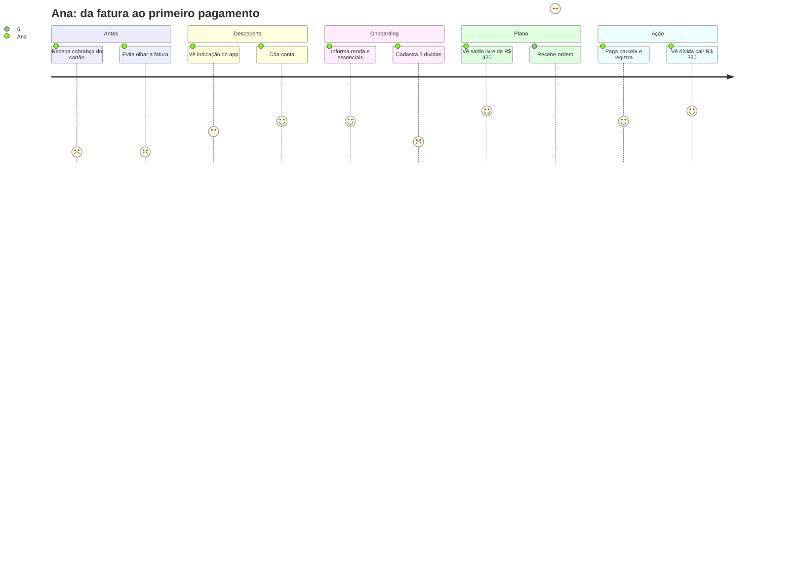
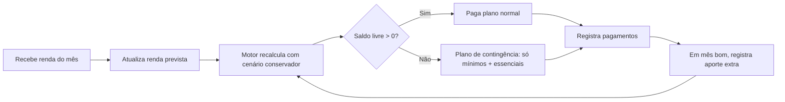

# 02 — Personas, Jobs-to-be-Done e Jornadas

**Objetivo:** traduzir o problema em usuários concretos, trabalhos a serem
realizados, jornadas e histórias acionáveis para design e engenharia.

---

## 1. Personas

### 1.1 Ana — "Quero sair do rotativo sem virar freira"

| Atributo | Descrição |
|----------|-----------|
| Idade | 32 anos |
| Ocupação | Analista administrativa (CLT) |
| Renda | R$ 4.200 líquidos/mês |
| Moradia | Aluga apartamento com a irmã |
| Dívidas | Cartão de crédito (R$ 6.800, rotativo), empréstimo pessoal (R$ 4.500), parcelado em 10x (R$ 2.400) |
| Ferramentas | App do banco, planilha abandonada, caderno |
| Letramento financeiro | Básico; confunde juros mensais e anuais |
| Tecnologia | Smartphone, usa tudo pelo celular |

**Dores**

- Paga o mínimo do cartão e o saldo não cai.
- Não sabe quanto do pagamento virou juros.
- Tem vergonha de olhar a fatura inteira.
- Já tentou planilha, mas abandonou em duas semanas.

**Ganhos desejados**

- Saber exatamente quanto pode pagar sem deixar de comer.
- Ver a dívida diminuir de forma visível.
- Ter um plano que não exija perfeição.

**Frase:** *"Eu só queria alguém me dissesse: paga isso primeiro, nessa ordem,
que em X meses você respira."*

**Critérios de sucesso:** reduzir a dívida total em 30% em 6 meses sem atrasar
contas essenciais.

---

### 1.2 Carlos — "Minha renda muda todo mês"

| Atributo | Descrição |
|----------|-----------|
| Idade | 45 anos |
| Ocupação | Autônomo (designer), MEI |
| Renda | R$ 3.000–R$ 9.000/mês, sazonal |
| Moradia | Casa própria com financiamento |
| Dívidas | Cheque especial (R$ 3.200), fornecedor (R$ 1.800), cartão (R$ 5.100), financiamento imobiliário |
| Ferramentas | App do banco, WhatsApp, caderno |
| Letramento financeiro | Intermediário; entende fluxo de caixa |
| Tecnologia | Notebook + celular |

**Dores**

- Em mês fraco, não sabe quanto pode pagar sem quebrar o negócio.
- Mistura despesas pessoais e do MEI.
- Juros do cheque especial consomem o caixa.

**Ganhos desejados**

- Plano conservador que funcione no pior mês.
- Separação clara entre pessoal e profissional.
- Reserva de emergência antes de acelerar quitação.

**Frase:** *"Meu problema não é não saber somar. É que meu mês nunca é igual."*

**Requisitos especiais:** renda variável, cenário conservador, reserva mínima,
possibilidade de aporte extra em meses bons.

---

### 1.3 Família Souza — "Cada um paga uma conta e ninguém vê o todo"

| Atributo | Descrição |
|----------|-----------|
| Idade | 38 e 40 anos |
| Ocupação | Professora e técnico de TI |
| Renda | R$ 9.500 combinados |
| Moradia | Apartamento financiado |
| Dívidas | Financiamento, cartão (R$ 12.000), consignado (R$ 7.000), parcelados (R$ 3.500), empréstimo familiar |
| Ferramentas | Cada um usa um app diferente |
| Letramento financeiro | Médio |
| Tecnologia | Dois smartphones + notebook |

**Dores**

- Falta visão consolidada do casal.
- Discussões sobre prioridades e "de quem é a dívida".
- Não sabem se o plano é sustentável para a família.

**Ganhos desejados**

- Um plano único, com responsabilidades claras.
- Metas compartilhadas e visão de progresso.
- Privacidade para gastos individuais (opcional).

**Frase:** *"A gente não briga por dinheiro, briga por falta de clareza."*

**Requisitos especiais:** workspace familiar (P1), papéis (owner/member),
consolidação de dívidas, categorias compartilhadas e privadas.

---

### 1.4 Persona secundária — "Operador self-hosted"

| Atributo | Descrição |
|----------|-----------|
| Perfil | Entusiasta de privacidade, profissional de TI ou pequeno escritório de finanças pessoais |
| Objetivo | Rodar o app no próprio servidor, com backups e controle de acesso |
| Dores | SaaS que vende dados, dependência de terceiros, falta de exportação |
| Necessidades | Docker Compose, documentação de deploy, backup/restore, logs, atualização segura |
| Sucesso | `docker compose up -d` funcionando em < 30 min, com TLS e backup |

---

### 1.5 Anti-personas

- **Especulador/investidor:** busca carteira, cotações e alocação — fora de escopo.
- **Empresa:** precisa de contabilidade, notas fiscais e folha — fora de escopo.
- **Usuário que quer crédito fácil:** o app não vende crédito nem promete aprovação.
- **Quem busca aconselhamento jurídico:** o app informa e educa, não substitui advogado.

---

## 2. Jobs-to-be-Done (JTBD)

### 2.1 Job principal

> **Quando** minha renda não cobre todos os compromissos e eu tenho várias dívidas,
> **quero** saber qual pagar primeiro e quanto posso pagar sem comprometer o essencial,
> **para** reduzir juros, evitar negativação e recuperar o controle da minha vida financeira.

### 2.2 Jobs relacionados

| # | Job | Contexto | Resultado desejado |
|---|-----|----------|--------------------|
| J1 | Entender minha situação | Início do mês / cobrança | Diagnóstico claro em < 5 min |
| J2 | Decidir o próximo pagamento | Recebimento da renda | Ordem e valor definidos |
| J3 | Comparar caminhos | Antes de decidir | Impacto em juros e prazo |
| J4 | Negociar com credor | Cobrança / proposta | Valor sustentável e argumento |
| J5 | Manter o plano | Durante o mês | Lembrete e registro fácil |
| J6 | Ver progresso | Fim do mês | Redução visível e motivação |
| J7 | Proteger minha privacidade | Sempre | Controle e exportação |
| J8 | Envolver a família | Decisão conjunta | Visão consolidada e acordo |

### 2.3 Forças que influenciam a adoção (JTBD Forces)

| Força | Exemplos | Como o produto responde |
|-------|----------|-------------------------|
| **Push** (dor) | Juros, cobrança, vergonha | Diagnóstico honesto e acolhedor |
| **Pull** (desejo) | Sair do vermelho, respirar | Plano com data de quitação |
| **Ansiedade** | "Vou ter que cortar tudo?" | Simulador e plano realista |
| **Hábito** | Planilha, caderno, app do banco | Onboarding rápido e importação |

---

## 3. Jornadas

### 3.1 Jornada de Ana (primeira semana)

**Pontos de fricção e soluções**

| Etapa | Fricção | Solução |
|-------|---------|---------|
| Cadastro de dívidas | Não sabe a taxa | Campo opcional + ajuda "onde encontro isso?" + estimativa por tipo |
| Onboarding | Muitos campos | Wizard com "pular e completar depois" |
| Plano | "Não tenho R$ 420" | Ajuste fino do orçamento e sugestão de corte |
| Registro | Esquece | Lembrete e botão "paguei" no e-mail/notificação |

### 3.2 Jornada de Carlos (mês variável)

**Decisões de produto**

- Renda variável: usar **média dos últimos 3 meses** e permitir cenário conservador
  (ex.: 70% da média).
- Aporte extra: campo opcional no mês, com impacto imediato no plano.
- Alerta quando o saldo projetado ficar negativo.

### 3.3 Jornada da Família Souza (P1)

1. Um membro cria o workspace e convida o outro.
2. Cada um cadastra suas dívidas e despesas (com opção de privacidade).
3. App consolida e calcula o plano familiar.
4. Casal revisa junto e define prioridades.
5. App atribui responsáveis por pagamento (opcional).

**Regras de privacidade:** gastos marcados como "privados" não aparecem para
outros membros; dívidas compartilhadas aparecem para todos. Consentimento explícito.

---

## 4. Mapa de histórias (Story Map)

```mermaid
flowchart TB
    subgraph Atividades
        A1[Configurar perfil]
        A2[Registrar transações]
        A3[Cadastrar dívidas]
        A4[Diagnosticar]
        A5[Gerar plano]
        A6[Simular]
        A7[Executar]
        A8[Revisar]
    end
    A1 --> A1a[Onboarding]
    A1 --> A1b[Editar perfil]
    A1 --> A1c[Configurar essenciais]
    A2 --> A2a[Lançamento rápido]
    A2 --> A2b[Recorrência]
    A2 --> A2c[Importar CSV/OFX]
    A3 --> A3a[Cadastrar dívida]
    A3 --> A3b[Histórico de pagamentos]
    A4 --> A4a[Dashboard]
    A4 --> A4b[Alertas]
    A5 --> A5a[Ordem]
    A5 --> A5b[Calendário]
    A5 --> A5c[Comparar estratégias]
    A6 --> A6a[Cortar despesa]
    A6 --> A6b[Renda extra]
    A6 --> A6c[Renegociar]
    A7 --> A7a[Registrar pagamento]
    A7 --> A7b[Recalcular]
    A8 --> A8a[Relatório mensal]
    A8 --> A8b[Exportar]
```

### 4.1 Fatiamento do MVP (walking skeleton)

**Fatia 1 — "Consigo me ver"**
Onboarding → transações básicas → dívidas → dashboard.

**Fatia 2 — "Sei o que fazer"**
Motor → plano → calendário.

**Fatia 3 — "Consigo comparar e ajustar"**
Comparação de estratégias → simulador.

**Fatia 4 — "Consigo executar"**
Registrar pagamentos → recálculo → relatório.

---

## 5. Histórias de usuário detalhadas

> Formato: Como [persona], quero [ação], para [resultado].
> Critérios de aceite em Gherkin quando útil.

### Épico 1 — Conta e perfil

**US-101 — Criar conta**
Como novo usuário, quero criar uma conta com e-mail e senha, para acessar meu
espaço financeiro.

- [ ] E-mail único e validado.
- [ ] Senha com política mínima (≥ 10 caracteres, verificação de vazamento).
- [ ] Termos e política de privacidade aceitos com registro de consentimento.
- [ ] Usuário criado com perfil financeiro vazio.
- [ ] E-mail de boas-vindas (se configurado).

**US-102 — Completar perfil financeiro**
Como usuário, quero informar renda, despesas essenciais e mínimo existencial,
para que o plano seja realista.

- [ ] Campos: renda líquida mensal, moeda, dependentes, despesas essenciais.
- [ ] Mínimo existencial sugerido com base nas essenciais, editável.
- [ ] Validação: valores ≥ 0; renda > 0 para gerar plano.
- [ ] "Como calculamos" disponível.

**US-103 — Renda variável**
Como autônomo, quero informar uma renda conservadora, para não assumir
compromissos que não consigo honrar.

- [ ] Renda base = média de 3 meses (se histórico) ou valor informado.
- [ ] Fator conservador configurável (50–100%).
- [ ] Plano exibe cenário conservador e base.

### Épico 2 — Transações

**US-201 — Lançamento rápido**
Como usuário, quero lançar uma despesa em até 3 toques, para não abandonar o app.

- [ ] Valor, data (padrão hoje), categoria e tipo.
- [ ] Salvar e lançar outro.
- [ ] Feedback imediato e possibilidade de desfazer.

**US-202 — Recorrência**
Como usuário, quero cadastrar aluguel e salário como recorrentes, para não
relançar todo mês.

- [ ] Frequência: mensal, semanal, anual (MVP: mensal).
- [ ] Dia de vencimento e data de início/fim.
- [ ] Geração automática idempotente (sem duplicar).
- [ ] Edição afeta apenas ocorrências futuras (padrão) ou todas (com confirmação).

**US-203 — Parcelamento**
Como usuário, quero registrar uma compra em 10x, para ver o impacto mensal.

- [ ] Valor total, número de parcelas, primeiro vencimento.
- [ ] Gera N transações futuras vinculadas.
- [ ] Exibe valor da parcela e saldo devedor restante.

**US-204 — Importar CSV/OFX (P1)**
Como usuário, quero importar meu extrato, para reduzir digitação.

- [ ] Mapeamento de colunas e pré-visualização.
- [ ] Deduplicação por data + valor + descrição.
- [ ] Relatório de importados/ignorados/erros.

### Épico 3 — Dívidas

**US-301 — Cadastrar dívida**
Como usuário, quero cadastrar uma dívida com saldo, taxa e parcela, para incluí-la
no plano.

- [ ] Campos obrigatórios: credor/apelido, saldo atual, parcela mínima, vencimento.
- [ ] Taxa mensal ou anual (pelo menos uma); CET opcional.
- [ ] Tipo: cartão rotativo, cheque especial, empréstimo, consignado, parcelado,
  financiamento, outro.
- [ ] Status: ativa, quitada, renegociada, em atraso.
- [ ] Ajuda contextual para encontrar a taxa.

**US-302 — Editar saldo e taxa**
Como usuário, quero corrigir o saldo e a taxa quando o banco mudar, para manter
o plano preciso.

- [ ] Edição gera evento de auditoria.
- [ ] Plano é marcado como desatualizado até recálculo.
- [ ] Histórico de alterações visível.

**US-303 — Registrar pagamento**
Como usuário, quero registrar o pagamento de uma dívida, para acompanhar a quitação.

- [ ] Valor, data, tipo (mínimo, parcela, extra).
- [ ] Baixa o saldo (principal + juros, conforme informado).
- [ ] Atualiza plano e calendário.
- [ ] Idempotente por chave de idempotência; evita duplicidade.

**US-304 — Quitar dívida**
Como usuário, quero marcar uma dívida como quitada, para removê-la do plano.

- [ ] Confirmação com valor final.
- [ ] Registro de data e forma de quitação.
- [ ] Recalcula distribuição do valor liberado.

### Épico 4 — Diagnóstico

**US-401 — Dashboard**
Como usuário, quero ver minha situação em uma tela, para saber se estou no caminho.

- [ ] Receitas, despesas, saldo do mês.
- [ ] Dívida total e variação vs. mês anterior.
- [ ] Taxa de comprometimento e DTI.
- [ ] Saldo livre e próximo pagamento recomendado.
- [ ] Estado vazio explicativo.

**US-402 — Alertas**
Como usuário, quero ser avisado quando algo sair do plano, para corrigir a tempo.

- [ ] Saldo livre ≤ 0.
- [ ] Comprometimento > 50%.
- [ ] Parcela vencendo em 3 dias.
- [ ] Dívida com juros > pagamento (amortização negativa).
- [ ] Plano desatualizado após mudança de renda/dívida.

### Épico 5 — Plano

**US-501 — Gerar plano**
Como usuário, quero gerar um plano de pagamento, para saber o que fazer.

- [ ] Selecionar estratégia (avalanche, snowball, híbrida).
- [ ] Calcular ordem, valores, juros e data de quitação.
- [ ] Exibir memória de cálculo e premissas.
- [ ] Bloquear geração se dados mínimos ausentes, com orientação.
- [ ] Aviso quando plano > 60 meses ou inviável.

**US-502 — Comparar estratégias**
Como usuário, quero comparar métodos, para escolher com consciência.

- [ ] Tabela: juros totais, prazo, número de credores quitados em 6/12 meses.
- [ ] Recomendação padrão explicada (híbrida).
- [ ] Permitir "aplicar esta estratégia".

**US-503 — Ver calendário**
Como usuário, quero um calendário mês a mês, para me organizar.

- [ ] Cada mês: dívida, pagamento, juros, saldo restante.
- [ ] Destaque do próximo pagamento.
- [ ] Exportar CSV/PDF (P1).
- [ ] Navegação por mês e visão anual.

**US-504 — Entender a ordem**
Como usuário, quero saber por que uma dívida veio primeiro, para confiar no plano.

- [ ] Explicação: taxa, saldo, estratégia, regra de desempate.
- [ ] Link para o método.
- [ ] Aviso quando a ordem foi travada manualmente.

### Épico 6 — Simulador

**US-601 — Simular corte de despesa**
Como usuário, quero simular um corte mensal, para ver o impacto.

- [ ] Slider/entrada de valor (R$ 50–2.000).
- [ ] Resultado: nova data, juros economizados, diferença de parcelas.
- [ ] Comparação antes/depois.
- [ ] "Aplicar ao plano" (opcional).

**US-602 — Simular renda extra**
Como usuário, quero simular um valor extra recorrente ou pontual.

- [ ] Recorrente por N meses ou único.
- [ ] Impacto no prazo e juros.
- [ ] Alerta se o aporte for insuficiente para mudar a ordem.

**US-603 — Simular renegociação**
Como usuário, quero simular nova taxa/prazo/desconto, para avaliar uma proposta.

- [ ] Entradas: nova taxa, novo prazo, desconto, entrada.
- [ ] Comparação com dívida atual.
- [ ] Indicação de economia ou custo adicional.
- [ ] Disclaimer de que não é recomendação.

### Épico 7 — Relatórios e dados

**US-701 — Relatório mensal**
Como usuário, quero ver o resumo do mês, para acompanhar a evolução.

- [ ] Receitas, despesas por categoria, dívidas pagas.
- [ ] Comparação com mês anterior.
- [ ] Exportar PDF (P1).

**US-702 — Exportar dados**
Como usuário, quero baixar todos os meus dados, para portabilidade.

- [ ] JSON completo + CSV de transações e dívidas.
- [ ] Download autenticado e auditado.
- [ ] Prazo e formato documentados.

**US-703 — Excluir conta**
Como usuário, quero excluir minha conta e dados, para exercer meu direito.

- [ ] Confirmação em duas etapas.
- [ ] Exclusão ou anonimização conforme LGPD.
- [ ] Registro de auditoria sem dados pessoais.
- [ ] Prazo informado (ex.: 30 dias para backups).

---

## 6. Matriz de prioridade (MoSCoW)

| Must (MVP) | Should (P1) | Could (P2) | Won't (fora) |
|------------|-------------|------------|--------------|
| Auth e perfil | Importação CSV/OFX | Open Finance | Investimentos |
| Transações | Lembretes e-mail | Workspace familiar | IRPF |
| Dívidas | Relatório PDF | PWA offline | Crédito/pagamentos |
| Dashboard | Orçamento por categoria | IA assistiva | Contabilidade |
| Motor e plano | Multimoeda | App nativo | Consultoria |
| Comparação | Metas de poupança | Alertas push | |
| Simulador | | | |
| Pagamentos | | | |
| Exportação CSV/JSON | | | |

---

## 7. Critérios de aceite transversais

- **Acessibilidade:** navegação por teclado, foco visível, contraste AA, labels
  associados, mensagens de erro anunciadas; respeitar `prefers-reduced-motion`
  e `prefers-reduced-transparency`.
- **Responsividade:** funciona em 360 px; tabelas viram cards no mobile.
- **Design:** Material Design 3 como base, Glassmorphism só em superfícies de
  destaque, com fallback sólido (doc 11).
- **Idempotência:** operações financeiras (pagamentos, recorrências) não duplicam.
- **Auditoria:** criação/edição/exclusão de dívidas e pagamentos registradas.
- **Privacidade:** nenhum dado de um usuário acessível por outro, inclusive via API.
- **Explicabilidade:** todo número do plano tem origem rastreável.

---

## 8. Definição de pronto (DoD) por história

1. Critérios de aceite implementados e testados.
2. Testes unitários e de integração verdes.
3. Revisão de código aprovada.
4. Sem regressões nos cálculos financeiros.
5. Documentação atualizada (se mudar regra).
6. Acessibilidade básica verificada.
7. Telemetria (se aplicável) sem dados sensíveis.

---

## 9. Riscos de UX e mitigação

| Risco | Sinal | Mitigação |
|-------|-------|-----------|
| Onboarding longo | Abandono no passo 2 | Salvar progresso, pular etapas, valor incremental |
| Dados imprecisos | Plano irreal | Campos opcionais, estimativas por tipo, aviso de premissas |
| Plano inviável | Frustração | Diagnóstico honesto + caminhos alternativos |
| Vergonha | Evita o app | Copy acolhedora, sem vermelho agressivo, foco em progresso |
| Complexidade | Não entende o plano | Explicação em 1 frase + detalhe sob demanda |
| Notificações excessivas | Desinstala | Frequência configurável, só eventos acionáveis |
