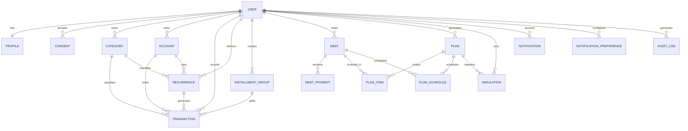

# 05 — Modelo de Dados

**Objetivo:** especificar entidades, relacionamentos, campos, constraints e
índices do PostgreSQL, servindo de base para as migrations Django.

**Banco:** PostgreSQL 16 · **ORM:** Django ORM · **Chaves:** UUID v4
**Valores:** `NUMERIC(14,2)` · **Taxas:** `NUMERIC(12,10)` (fração decimal)

---

## 1. Convenções

| Convenção | Regra |
|-----------|-------|
| PK | `id UUID DEFAULT gen_random_uuid()` |
| Timestamps | `created_at`, `updated_at` (UTC no banco; exibição em America/Sao_Paulo) |
| Soft delete | `deleted_at TIMESTAMPTZ NULL` em entidades editáveis |
| Dinheiro | `NUMERIC(14,2)`; nunca `FLOAT`/`REAL` |
| Taxa | Fração decimal mensal (`0.0199` = 1,99% a.m.) |
| Competência | `competence_month DATE` normalizada para o dia 1 |
| Enums | `VARCHAR` + `CHECK` (ou enum Django) para evolução simples |
| Nomenclatura | Tabelas `snake_case` plural; FKs `<entidade>_id` |
| Isolamento | Toda tabela de negócio tem `user_id` (ou `workspace_id` no P1) |
| Auditoria | `audit_log` append-only |

---

## 2. Diagrama ER (visão geral)



---

## 3. App `accounts`

### 3.1 `users`

| Campo | Tipo | Null | Default | Descrição |
|-------|------|------|---------|-----------|
| `id` | UUID | não | `gen_random_uuid()` | PK |
| `email` | CITEXT | não | — | Único, login |
| `password` | VARCHAR(128) | não | — | Hash Argon2id |
| `full_name` | VARCHAR(150) | sim | — | Nome de exibição |
| `is_active` | BOOLEAN | não | `true` | Conta ativa |
| `is_staff` | BOOLEAN | não | `false` | Acesso ao admin |
| `last_login` | TIMESTAMPTZ | sim | — | Último login |
| `date_joined` | TIMESTAMPTZ | não | `now()` | Criação |
| `deleted_at` | TIMESTAMPTZ | sim | — | Exclusão lógica |

**Constraints/índices:** `UNIQUE(email) WHERE deleted_at IS NULL`; índice em `email`.

### 3.2 `profiles`

| Campo | Tipo | Null | Default | Descrição |
|-------|------|------|---------|-----------|
| `id` | UUID | não | — | PK |
| `user_id` | UUID | não | — | FK `users` (1:1, CASCADE) |
| `currency` | CHAR(3) | não | `BRL` | Moeda |
| `timezone` | VARCHAR(64) | não | `America/Sao_Paulo` | Fuso |
| `gross_income` | NUMERIC(14,2) | sim | — | Renda bruta mensal |
| `net_income` | NUMERIC(14,2) | sim | — | Renda líquida mensal |
| `essential_expenses` | NUMERIC(14,2) | sim | — | Despesas essenciais |
| `min_existential` | NUMERIC(14,2) | sim | — | Mínimo existencial |
| `income_type` | VARCHAR(16) | não | `fixed` | `fixed`/`variable` |
| `conservative_factor` | NUMERIC(4,3) | não | `0.80` | Fator p/ renda variável |
| `dependents` | SMALLINT | não | `0` | Dependentes |
| `onboarding_completed_at` | TIMESTAMPTZ | sim | — | Conclusão |
| `created_at`/`updated_at` | TIMESTAMPTZ | não | `now()` | — |

**Checks:** `net_income >= 0`, `essential_expenses >= 0`, `min_existential >= 0`,
`conservative_factor BETWEEN 0.3 AND 1.0`, `dependents >= 0`.

### 3.3 `consents`

| Campo | Tipo | Null | Descrição |
|-------|------|------|-----------|
| `id` | UUID | não | PK |
| `user_id` | UUID | não | FK users |
| `kind` | VARCHAR(32) | não | `terms`, `privacy`, `telemetry`, `marketing` |
| `version` | VARCHAR(20) | não | Versão do documento |
| `accepted` | BOOLEAN | não | Consentimento |
| `accepted_at` | TIMESTAMPTZ | não | Data/hora |
| `ip_hash` | CHAR(64) | sim | SHA-256 do IP (não reversível) |
| `user_agent_hash` | CHAR(64) | sim | SHA-256 |

**Índice:** `(user_id, kind, version)`.

---

## 4. App `finance`

### 4.1 `categories`

| Campo | Tipo | Null | Default | Descrição |
|-------|------|------|---------|-----------|
| `id` | UUID | não | — | PK |
| `user_id` | UUID | não | — | FK users |
| `name` | VARCHAR(80) | não | — | Nome |
| `kind` | VARCHAR(10) | não | — | `income`/`expense` |
| `is_essential` | BOOLEAN | não | `false` | Essencial |
| `color` | CHAR(7) | sim | — | Hex |
| `icon` | VARCHAR(40) | sim | — | Nome do ícone |
| `is_system` | BOOLEAN | não | `false` | Seed |
| `archived_at` | TIMESTAMPTZ | sim | — | Arquivada |
| `created_at`/`updated_at` | TIMESTAMPTZ | não | `now()` | — |

**Constraints:** `UNIQUE(user_id, kind, lower(name)) WHERE archived_at IS NULL`;
`CHECK (kind IN ('income','expense'))`.

### 4.2 `accounts`

| Campo | Tipo | Null | Default | Descrição |
|-------|------|------|---------|-----------|
| `id` | UUID | não | — | PK |
| `user_id` | UUID | não | — | FK users |
| `name` | VARCHAR(80) | não | — | Ex.: "Nubank" |
| `type` | VARCHAR(20) | não | — | `checking`, `savings`, `cash`, `credit_card`, `investment`, `other` |
| `opening_balance` | NUMERIC(14,2) | não | `0` | Saldo inicial |
| `archived_at` | TIMESTAMPTZ | sim | — | — |
| `created_at`/`updated_at` | TIMESTAMPTZ | não | `now()` | — |

**Índice:** `(user_id, archived_at)`.

### 4.3 `recurrences`

| Campo | Tipo | Null | Default | Descrição |
|-------|------|------|---------|-----------|
| `id` | UUID | não | — | PK |
| `user_id` | UUID | não | — | FK users |
| `description` | VARCHAR(140) | não | — | Ex.: "Aluguel" |
| `kind` | VARCHAR(10) | não | — | `income`/`expense` |
| `amount` | NUMERIC(14,2) | não | — | Valor |
| `frequency` | VARCHAR(16) | não | `monthly` | MVP: mensal |
| `due_day` | SMALLINT | não | — | 1–31 |
| `start_date` | DATE | não | — | Início |
| `end_date` | DATE | sim | — | Fim |
| `category_id` | UUID | sim | — | FK categories |
| `account_id` | UUID | sim | — | FK accounts |
| `next_run` | DATE | não | — | Próxima competência |
| `is_active` | BOOLEAN | não | `true` | Ativa |
| `created_at`/`updated_at` | TIMESTAMPTZ | não | `now()` | — |

**Checks:** `amount > 0`, `due_day BETWEEN 1 AND 31`.
**Índice:** `(user_id, is_active, next_run)`.

### 4.4 `installment_groups`

| Campo | Tipo | Null | Descrição |
|-------|------|------|-----------|
| `id` | UUID | não | PK |
| `user_id` | UUID | não | FK users |
| `description` | VARCHAR(140) | não | Ex.: "Notebook 10x" |
| `total_amount` | NUMERIC(14,2) | não | Total |
| `installments` | SMALLINT | não | 2–360 |
| `first_due_date` | DATE | não | Primeira parcela |
| `category_id` | UUID | sim | FK categories |
| `account_id` | UUID | sim | FK accounts |
| `created_at` | TIMESTAMPTZ | não | — |

**Check:** `installments BETWEEN 2 AND 360`, `total_amount > 0`.

### 4.5 `transactions`

| Campo | Tipo | Null | Default | Descrição |
|-------|------|------|---------|-----------|
| `id` | UUID | não | — | PK |
| `user_id` | UUID | não | — | FK users |
| `account_id` | UUID | sim | — | FK accounts |
| `category_id` | UUID | sim | — | FK categories |
| `recurrence_id` | UUID | sim | — | FK recurrences |
| `installment_group_id` | UUID | sim | — | FK installment_groups |
| `installment_number` | SMALLINT | sim | — | 1..N |
| `kind` | VARCHAR(10) | não | — | `income`/`expense` |
| `amount` | NUMERIC(14,2) | não | — | Valor |
| `description` | VARCHAR(200) | sim | — | Descrição |
| `transaction_date` | DATE | não | — | Data do fato |
| `competence_month` | DATE | não | — | Dia 1 do mês |
| `status` | VARCHAR(10) | não | `pending` | `pending`/`paid`/`canceled` |
| `paid_at` | DATE | sim | — | Data do pagamento |
| `notes` | TEXT | sim | — | Observações |
| `tags` | JSONB | sim | `[]` | Lista de tags (compatível com SQLite em dev) |
| `idempotency_key` | VARCHAR(80) | sim | — | Chave de idempotência |
| `deleted_at` | TIMESTAMPTZ | sim | — | Soft delete |
| `created_at`/`updated_at` | TIMESTAMPTZ | não | `now()` | — |

**Constraints:**

- `CHECK (amount > 0)`
- `CHECK (kind IN ('income','expense'))`
- `CHECK (status IN ('pending','paid','canceled'))`
- `UNIQUE(user_id, idempotency_key) WHERE idempotency_key IS NOT NULL`
- `UNIQUE(recurrence_id, competence_month) WHERE recurrence_id IS NOT NULL AND deleted_at IS NULL`
- `UNIQUE(installment_group_id, installment_number) WHERE installment_group_id IS NOT NULL AND deleted_at IS NULL`
- `CHECK (installment_number IS NULL OR installment_number >= 1)`
- `CHECK (status <> 'paid' OR paid_at IS NOT NULL)`

**Índices:**

- `(user_id, deleted_at, transaction_date DESC)`
- `(user_id, competence_month, status)`
- `(user_id, category_id)`
- `(user_id, account_id)`
- GIN em `tags` (P1, PostgreSQL)
- Busca textual em `description` (P1; `pg_trgm`)

**Regra de competência:** `competence_month = date_trunc('month', transaction_date)`.
Para parcelas futuras, a competência é o mês do vencimento.

---

## 5. App `debts`

### 5.1 `debts`

| Campo | Tipo | Null | Default | Descrição |
|-------|------|------|---------|-----------|
| `id` | UUID | não | — | PK |
| `user_id` | UUID | não | — | FK users |
| `creditor` | VARCHAR(120) | não | — | Credor |
| `nickname` | VARCHAR(80) | sim | — | Apelido |
| `type` | VARCHAR(24) | não | — | `credit_card`, `overdraft`, `personal_loan`, `payroll_loan`, `installment`, `mortgage`, `family`, `other` |
| `original_amount` | NUMERIC(14,2) | sim | — | Valor original |
| `current_balance` | NUMERIC(14,2) | não | — | Saldo devedor atual |
| `monthly_rate` | NUMERIC(12,10) | não | — | Taxa mensal (fração) |
| `annual_rate` | NUMERIC(12,10) | sim | — | Taxa anual (fração) |
| `cet` | NUMERIC(12,10) | sim | — | Custo efetivo total anual |
| `minimum_payment` | NUMERIC(14,2) | não | — | Parcela mínima |
| `installment_amount` | NUMERIC(14,2) | sim | — | Parcela contratada |
| `due_day` | SMALLINT | não | — | Dia de vencimento |
| `start_date` | DATE | sim | — | Início |
| `status` | VARCHAR(16) | não | `active` | `active`, `paid`, `renegotiated`, `late` |
| `priority_locked` | SMALLINT | sim | — | Ordem manual (P1) |
| `notes` | TEXT | sim | — | Observações |
| `deleted_at` | TIMESTAMPTZ | sim | — | Soft delete |
| `created_at`/`updated_at` | TIMESTAMPTZ | não | `now()` | — |

**Constraints:**

- `CHECK (current_balance >= 0)`
- `CHECK (minimum_payment > 0)`
- `CHECK (monthly_rate >= 0 AND monthly_rate <= 1)`
- `CHECK (annual_rate IS NULL OR annual_rate >= 0)`
- `CHECK (due_day BETWEEN 1 AND 31)`
- `CHECK (status IN ('active','paid','renegotiated','late'))`
- `CHECK (status <> 'paid' OR current_balance = 0)` — consistência
- `CHECK (current_balance > 0 OR status IN ('paid','renegotiated'))`

**Índices:** `(user_id, status, deleted_at)`, `(user_id, priority_locked)`.

**Regra de conversão:** se `annual_rate` informada e `monthly_rate` ausente,
`monthly_rate = (1 + annual_rate)^(1/12) − 1` (ver doc 06). Persistir ambas
quando possível para auditoria.

### 5.2 `debt_payments`

| Campo | Tipo | Null | Default | Descrição |
|-------|------|------|---------|-----------|
| `id` | UUID | não | — | PK |
| `user_id` | UUID | não | — | FK users (redundante p/ isolamento) |
| `debt_id` | UUID | não | — | FK debts (CASCADE lógico) |
| `amount` | NUMERIC(14,2) | não | — | Valor pago |
| `principal_amount` | NUMERIC(14,2) | sim | — | Principal |
| `interest_amount` | NUMERIC(14,2) | sim | — | Juros |
| `paid_at` | DATE | não | — | Data |
| `kind` | VARCHAR(16) | não | — | `minimum`, `installment`, `extra`, `settlement` |
| `note` | VARCHAR(200) | sim | — | — |
| `idempotency_key` | VARCHAR(80) | sim | — | — |
| `created_at` | TIMESTAMPTZ | não | `now()` | — |

**Constraints:**

- `CHECK (amount > 0)`
- `CHECK (kind IN ('minimum','installment','extra','settlement'))`
- `UNIQUE(user_id, idempotency_key) WHERE idempotency_key IS NOT NULL`

**Índices:** `(debt_id, paid_at DESC)`, `(user_id, paid_at DESC)`.

**Regra:** `amount = principal_amount + interest_amount` quando ambos informados;
se não, o serviço calcula pela ordem juros → principal.

---

## 6. App `plans`

### 6.1 `plans`

| Campo | Tipo | Null | Default | Descrição |
|-------|------|------|---------|-----------|
| `id` | UUID | não | — | PK |
| `user_id` | UUID | não | — | FK users |
| `label` | VARCHAR(80) | sim | — | Rótulo (ex.: cenário aplicado) |
| `strategy` | VARCHAR(12) | não | — | `avalanche`, `snowball`, `hybrid` |
| `status` | VARCHAR(16) | não | `active` | `active`, `archived`, `stale`, `infeasible`, `term_exceeded` |
| `engine_version` | VARCHAR(20) | não | — | Versão do motor |
| `input_snapshot` | JSONB | não | — | Parâmetros de entrada |
| `summary` | JSONB | não | — | Totais e datas |
| `monthly_available` | NUMERIC(14,2) | não | — | Orçamento para dívidas |
| `total_interest` | NUMERIC(14,2) | sim | — | Juros projetados |
| `total_paid` | NUMERIC(14,2) | sim | — | Total pago |
| `months_to_payoff` | SMALLINT | sim | — | Meses |
| `debt_free_date` | DATE | sim | — | Data estimada |
| `infeasible_reason` | VARCHAR(200) | sim | — | Motivo |
| `generated_at` | TIMESTAMPTZ | não | `now()` | — |
| `created_at`/`updated_at` | TIMESTAMPTZ | não | `now()` | — |

**Constraints:**

- `CHECK (strategy IN ('avalanche','snowball','hybrid'))`
- `CHECK (status IN ('active','archived','stale','infeasible'))`
- `CHECK (months_to_payoff IS NULL OR months_to_payoff <= 600)`
- **Índice único parcial:** `UNIQUE(user_id) WHERE status = 'active'`

**Índice:** `(user_id, generated_at DESC)`.

**Por que snapshot?** Garante reprodutibilidade: mudanças posteriores em renda ou
dívidas não alteram o plano histórico. O plano é marcado `stale` quando os dados
mudam; o usuário pode recalcular.

### 6.2 `plan_items`

| Campo | Tipo | Null | Descrição |
|-------|------|------|-----------|
| `id` | UUID | não | PK |
| `plan_id` | UUID | não | FK plans (CASCADE) |
| `debt_id` | UUID | não | FK debts |
| `debt_name` | VARCHAR(160) | sim | Nome histórico da dívida |
| `priority_order` | SMALLINT | não | 1 = primeiro |
| `reason` | VARCHAR(200) | não | Explicação legível |
| `projected_payoff_month` | DATE | sim | Competência da quitação |
| `projected_interest` | NUMERIC(14,2) | sim | Juros até quitar |
| `projected_total_paid` | NUMERIC(14,2) | sim | Total pago |

**Constraints:** `UNIQUE(plan_id, priority_order)`, `UNIQUE(plan_id, debt_id)`,
`CHECK (priority_order >= 1)`.

### 6.3 `plan_schedules`

| Campo | Tipo | Null | Descrição |
|-------|------|------|-----------|
| `id` | BIGSERIAL | não | PK (volume alto) |
| `plan_id` | UUID | não | FK plans (CASCADE) |
| `debt_id` | UUID | não | FK debts |
| `debt_name` | VARCHAR(160) | sim | Nome histórico da dívida |
| `competence_month` | DATE | não | Dia 1 |
| `payment` | NUMERIC(14,2) | não | Pagamento no mês |
| `interest` | NUMERIC(14,2) | não | Juros do mês |
| `principal` | NUMERIC(14,2) | não | Amortização (0 se não cobriu juros) |
| `capitalized_interest` | NUMERIC(14,2) | não (default 0) | Juros não pagos que capitalizaram |
| `closing_balance` | NUMERIC(14,2) | não | Saldo final |

**Constraints:**

- `UNIQUE(plan_id, debt_id, competence_month)`
- `CHECK (payment >= 0 AND interest >= 0 AND principal >= 0)`
- `CHECK (capitalized_interest >= 0 AND closing_balance >= 0)`
- Reconciliação `payment + capitalized_interest = interest + principal`
  validada na aplicação (evita diferenças de tipo numérico entre SQLite/PostgreSQL)
- `CHECK (principal = 0 OR capitalized_interest = 0)` — ou paga juros ou capitaliza

**Índice:** `(plan_id, competence_month)`.

> **Amortização negativa:** quando a parcela não cobre os juros,
> `principal = 0`, `capitalized_interest = interest − payment` e o saldo cresce.
> Isso permite representar o fenômeno sem valores negativos e mantém a
> reconciliação `closing = opening + capitalized_interest − principal`.

> **Volume:** 20 dívidas × 60 meses = 1.200 linhas por plano. Com 1.000 usuários e
> 12 planos/ano, ~14M linhas/ano — aceitável; arquivar planos antigos após 24 meses
> se necessário. Alternativa: armazenar calendário em JSONB comprimido. Optamos por
> tabela para consultas e exportação.

### 6.4 `plan_payments`

| Campo | Tipo | Null | Descrição |
|-------|------|------|-----------|
| `id` | UUID | não | PK |
| `user_id` | UUID | não | FK users |
| `plan_id` | UUID | não | FK plans (CASCADE) |
| `schedule_id` | BIGINT | não | FK plan_schedules (OneToOne, CASCADE) |
| `amount` | NUMERIC(14,2) | não | Valor pago (default = parcela planejada) |
| `paid_at` | DATE | não | Data do pagamento |
| `note` | VARCHAR(200) | sim | Observação |
| `created_at` | TIMESTAMPTZ | não | — |

**Constraint:** `CHECK (amount > 0)`; um pagamento por parcela planejada.
**Uso:** aderência ao plano; não substitui o pagamento real da dívida.


---

## 7. App `simulations`

### 7.1 `simulations`

| Campo | Tipo | Null | Descrição |
|-------|------|------|-----------|
| `id` | UUID | não | PK |
| `user_id` | UUID | não | FK users |
| `base_plan_id` | UUID | sim | FK plans |
| `name` | VARCHAR(80) | não | Ex.: "Cortar lazer R$ 300" |
| `kind` | VARCHAR(20) | não | `expense_cut`, `extra_income`, `renegotiation`, `conservative` |
| `params` | JSONB | não | Entradas do cenário |
| `result_summary` | JSONB | não | Prazo, juros, diferenças |
| `engine_version` | VARCHAR(20) | não | — |
| `applied_at` | TIMESTAMPTZ | sim | Se aplicado |
| `created_at` | TIMESTAMPTZ | não | — |

**Check:** `kind IN (...)`. **Índice:** `(user_id, created_at DESC)`.

**Formato de `params` (exemplo):**

```json
{
  "expense_cut": 300.00,
  "extra_income": 0,
  "extra_income_months": 0,
  "renegotiation": {
    "debt_id": "...",
    "new_rate": 0.015,
    "new_term_months": 24,
    "discount": 0.10
  },
  "conservative": { "income_factor": 0.8, "expense_factor": 1.1 }
}
```

**Não persistir dados sensíveis desnecessários**; params contêm apenas números e IDs.

---

## 8. App `notifications`

### 8.1 `notification_preferences`

| Campo | Tipo | Default | Descrição |
|-------|------|---------|-----------|
| `id` | UUID | — | PK |
| `user_id` | UUID | — | FK users (1:1) |
| `email_enabled` | BOOLEAN | `true` | E-mails transacionais |
| `due_reminders` | BOOLEAN | `true` | Lembretes de vencimento |
| `weekly_summary` | BOOLEAN | `false` | Resumo semanal |
| `risk_alerts` | BOOLEAN | `true` | Alertas de risco |
| `quiet_hours_start` | TIME | `22:00` | Início |
| `quiet_hours_end` | TIME | `08:00` | Fim |
| `updated_at` | TIMESTAMPTZ | `now()` | — |

### 8.2 `notifications`

| Campo | Tipo | Null | Descrição |
|-------|------|------|-----------|
| `id` | UUID | não | PK |
| `user_id` | UUID | não | FK users |
| `kind` | VARCHAR(32) | não | `due_reminder`, `risk_alert`, `weekly_summary`, `system` |
| `title` | VARCHAR(120) | não | — |
| `body` | VARCHAR(500) | não | Sem valores detalhados |
| `channel` | VARCHAR(12) | não | `in_app`, `email` |
| `status` | VARCHAR(12) | não | `pending`, `sent`, `read`, `failed` |
| `scheduled_at` | TIMESTAMPTZ | sim | — |
| `sent_at` | TIMESTAMPTZ | sim | — |
| `read_at` | TIMESTAMPTZ | sim | — |
| `payload` | JSONB | sim | IDs e links (sem PII) |
| `dedupe_key` | VARCHAR(120) | sim | Evita lembretes duplicados |
| `created_at` | TIMESTAMPTZ | não | — |

**Índices:** `(user_id, status, created_at DESC)`, `(scheduled_at)`;
**Unique:** `(user_id, dedupe_key) WHERE dedupe_key <> ''`.

---

## 9. App `audit`

### 9.1 `audit_logs`

| Campo | Tipo | Null | Descrição |
|-------|------|------|-----------|
| `id` | BIGSERIAL | não | PK |
| `user_id` | UUID | sim | FK users (SET NULL na exclusão) |
| `event` | VARCHAR(48) | não | `login`, `debt.created`, `payment.created`, `data.exported`, `account.deleted` |
| `entity_type` | VARCHAR(48) | sim | — |
| `entity_id` | UUID | sim | — |
| `metadata` | JSONB | sim | **Sem PII/valores** |
| `ip_hash` | CHAR(64) | sim | SHA-256 |
| `user_agent_hash` | CHAR(64) | sim | SHA-256 |
| `created_at` | TIMESTAMPTZ | não | — |

**Índices:** `(user_id, created_at DESC)`, `(event, created_at DESC)`.
**Política:** append-only; sem update/delete pela aplicação. Retenção 5 anos
(ou conforme política de privacidade), com anonimização de `user_id` na exclusão.

---

## 10. Relacionamentos e regras de integridade

| Relação | Cardinalidade | On delete | Observação |
|---------|---------------|-----------|------------|
| User → Profile | 1:1 | CASCADE | Perfil sempre existe |
| User → Category/Account | 1:N | CASCADE | Dados do usuário |
| User → Transaction | 1:N | CASCADE | Soft delete primeiro |
| Recurrence → Transaction | 1:N | SET NULL | Preserva histórico |
| InstallmentGroup → Transaction | 1:N | SET NULL | Preserva histórico |
| Debt → DebtPayment | 1:N | CASCADE | Pagamentos da dívida |
| Plan → PlanItem/Schedule | 1:N | CASCADE | Plano é agregado |
| Debt → PlanItem | 1:N | RESTRICT | Não apagar dívida com plano ativo |
| Plan → Simulation | 1:N | SET NULL | Simulação histórica |

**Exclusão de dívida:** soft delete; se houver plano ativo, marcar plano `stale`
e exigir recálculo. Nunca apagar fisicamente enquanto houver referências.

---

## 11. Índices e performance

| Consulta | Índice |
|----------|--------|
| Transações por período | `(user_id, deleted_at, transaction_date DESC)` |
| Dashboard do mês | `(user_id, competence_month, status)` |
| Dívidas ativas | `(user_id, status, deleted_at)` |
| Pagamentos por dívida | `(debt_id, paid_at DESC)` |
| Plano ativo | `UNIQUE(user_id) WHERE status='active'` |
| Calendário | `(plan_id, competence_month)` |
| Fila de notificações | `(scheduled_at) WHERE status='pending'` |

**Boas práticas:**

- `select_related`/`prefetch_related` em listagens.
- Paginação obrigatória (25/50/100).
- Evitar `COUNT(*)` em tabelas grandes no dashboard; usar agregações cacheadas (P1).
- `EXPLAIN ANALYZE` nas consultas do dashboard antes do beta.

---

## 12. Migrations e versionamento

- Cada app tem suas migrations; nunca editar migration aplicada.
- Migrations destrutivas exigem plano de rollback (ADRs).
- Dados de seed (categorias padrão) via `RunPython` idempotente ou comando.
- Alterações de cálculo **não** alteram planos históricos; incrementar
  `engine_version` e permitir recalcular.
- Backfill em lotes (`batch_size=1000`) para tabelas grandes.

---

## 13. Privacidade no modelo de dados

| Dado | Classificação | Tratamento |
|------|---------------|------------|
| E-mail, nome | Pessoal | Necessário para conta; exclusão/anonimização |
| Renda, dívidas, transações | Pessoal sensível (contexto) | Criptografia em repouso (disco/backup), acesso restrito |
| Senha | Segredo | Hash Argon2id, nunca logada |
| IP/User-Agent | Pessoal | Apenas hash SHA-256, finalidade de segurança |
| Logs de auditoria | Pessoal | Sem valores; retenção definida |
| Telemetria | Agregada | Opt-in, sem valores |

**Direitos LGPD:** exportação completa (JSON/CSV), correção, exclusão/anonimização,
informação sobre compartilhamento (não há, no MVP).

---

## 14. DDL ilustrativo (recorte)

```sql
CREATE TABLE debts (
    id UUID PRIMARY KEY DEFAULT gen_random_uuid(),
    user_id UUID NOT NULL REFERENCES users(id) ON DELETE CASCADE,
    creditor VARCHAR(120) NOT NULL,
    nickname VARCHAR(80),
    type VARCHAR(24) NOT NULL,
    original_amount NUMERIC(14,2),
    current_balance NUMERIC(14,2) NOT NULL CHECK (current_balance >= 0),
    monthly_rate NUMERIC(12,10) NOT NULL CHECK (monthly_rate >= 0 AND monthly_rate <= 1),
    annual_rate NUMERIC(12,10),
    cet NUMERIC(12,10),
    minimum_payment NUMERIC(14,2) NOT NULL CHECK (minimum_payment > 0),
    installment_amount NUMERIC(14,2),
    due_day SMALLINT NOT NULL CHECK (due_day BETWEEN 1 AND 31),
    start_date DATE,
    status VARCHAR(16) NOT NULL DEFAULT 'active'
        CHECK (status IN ('active','paid','renegotiated','late')),
    priority_locked SMALLINT,
    notes TEXT,
    deleted_at TIMESTAMPTZ,
    created_at TIMESTAMPTZ NOT NULL DEFAULT now(),
    updated_at TIMESTAMPTZ NOT NULL DEFAULT now(),
    CHECK (status <> 'paid' OR current_balance = 0)
);

CREATE INDEX idx_debts_user_status ON debts (user_id, status, deleted_at);

CREATE TABLE plan_schedules (
    id BIGSERIAL PRIMARY KEY,
    plan_id UUID NOT NULL REFERENCES plans(id) ON DELETE CASCADE,
    debt_id UUID NOT NULL REFERENCES debts(id),
    competence_month DATE NOT NULL,
    payment NUMERIC(14,2) NOT NULL CHECK (payment >= 0),
    interest NUMERIC(14,2) NOT NULL CHECK (interest >= 0),
    principal NUMERIC(14,2) NOT NULL CHECK (principal >= 0),
    capitalized_interest NUMERIC(14,2) NOT NULL DEFAULT 0
        CHECK (capitalized_interest >= 0),
    closing_balance NUMERIC(14,2) NOT NULL CHECK (closing_balance >= 0),
    CHECK (payment + capitalized_interest = interest + principal),
    UNIQUE (plan_id, debt_id, competence_month)
);

CREATE INDEX idx_schedules_plan_month ON plan_schedules (plan_id, competence_month);
```

---

## 15. Checklist de modelagem

- [ ] Todas as tabelas de negócio têm `user_id` e índice correspondente.
- [ ] Dinheiro em `NUMERIC`, taxas em fração decimal.
- [ ] Constraints de faixa e consistência implementadas.
- [ ] Idempotência em recorrências e pagamentos.
- [ ] Soft delete e auditoria.
- [ ] Plano com snapshot + `engine_version`.
- [ ] Índices para as consultas do dashboard.
- [ ] Exportação/exclusão cobertas pelas entidades.
- [ ] Sem PII em logs, `metadata` e telemetria.
