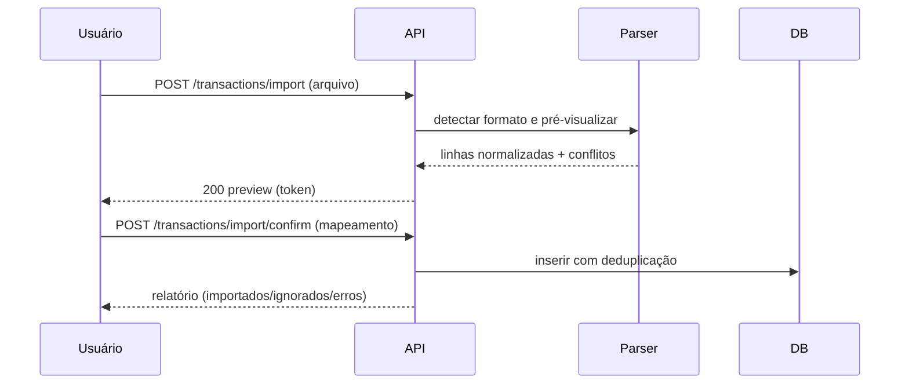

# 07 — API e Integrações

**Objetivo:** definir os contratos da API REST do MVP, padrões de autenticação,
erros, paginação, idempotência e o caminho de evolução para integrações
(importação e Open Finance).

**Base:** `/api/v1` · **Formato:** JSON (`application/json`) · **Charset:** UTF-8
**Datas:** `YYYY-MM-DD` · **Timestamps:** ISO-8601 com offset
**Valores:** string decimal (`"1234.56"`) para evitar erro de ponto flutuante.

---

## 1. Princípios

1. **Recursos previsíveis** — substantivos no plural, verbos apenas em ações.
2. **Versionamento explícito** — `/api/v1`; quebra de contrato ⇒ `/api/v2`.
3. **Erros padronizados** — RFC 7807 (`application/problem+json`).
4. **Idempotência** — operações financeiras aceitam `Idempotency-Key`.
5. **Isolamento** — todo recurso é escopado ao usuário autenticado.
6. **Paginação obrigatória** — nenhuma listagem retorna tudo.
7. **Sem dados sensíveis em URLs** — nada de valores/credores em query string de log.
8. **Documentação viva** — OpenAPI 3.1 gerado pelo DRF (drf-spectacular).

---

## 2. Autenticação e sessão

### 2.1 Web (MVP)

- Sessão Django em cookie `Secure`, `HttpOnly`, `SameSite=Lax`.
- CSRF token obrigatório em métodos mutáveis (`POST`, `PUT`, `PATCH`, `DELETE`).
- Login por e-mail + senha (Argon2id).
- Logout invalida a sessão.

### 2.2 API (P1)

- Token pessoal (`Authorization: Bearer <token>`) com escopos:
  `read`, `write`, `plans`, `exports`.
- Tokens com hash no banco, expiração e revogação.
- MFA opcional (TOTP) para login.

### 2.3 Segurança

| Controle | Regra |
|----------|-------|
| Rate limit login | 5 tentativas / 15 min por IP + e-mail |
| Rate limit recuperação | 3 / hora por e-mail |
| Rate limit API | 120 req/min por usuário (P1) |
| Bloqueio | Após 10 falhas, desafio adicional/atraso |
| Sessão | Expira por inatividade (configurável, padrão 60 min) |
| Auditoria | Login, logout, falhas, exportação, exclusão |

---

## 3. Convenções de request/response

### 3.1 Headers

| Header | Uso |
|--------|-----|
| `Content-Type: application/json` | Requests com corpo |
| `Accept: application/json` | Respostas |
| `X-CSRFToken` | Web (métodos mutáveis) |
| `Authorization: Bearer ...` | API token (P1) |
| `Idempotency-Key` | POSTs financeiros |
| `X-Request-ID` | Correlação (ecoado na resposta) |
| `If-Match` | Atualização otimista (P1) |

### 3.2 Envelope

**Sucesso (recurso único):**

```json
{
  "data": { "id": "uuid", "...": "..." },
  "meta": { "request_id": "..." }
}
```

**Sucesso (lista):**

```json
{
  "data": [ { "id": "uuid" } ],
  "meta": {
    "request_id": "...",
    "pagination": { "next": "cursor", "previous": null, "count": 42 }
  }
}
```

**Erro (RFC 7807):**

```json
{
  "type": "https://api.clareza.app/errors/validation",
  "title": "Dados inválidos",
  "status": 422,
  "detail": "Informe um valor maior que zero.",
  "code": "validation_error",
  "instance": "/api/v1/debts",
  "request_id": "req_01H...",
  "errors": [
    { "field": "minimum_payment", "code": "gt_zero", "message": "Informe a parcela mínima." }
  ]
}
```

### 3.3 Códigos de status

| Código | Uso |
|--------|-----|
| 200 | Consulta/atualização ok |
| 201 | Criação |
| 202 | Processamento assíncrono aceito (recálculo) |
| 204 | Exclusão/ação sem corpo |
| 400 | Requisição malformada |
| 401 | Não autenticado |
| 403 | Sem permissão |
| 404 | Não encontrado (também para recurso de outro usuário) |
| 409 | Conflito (idempotência/estado) |
| 422 | Validação de negócio |
| 429 | Rate limit |
| 500 | Erro interno (sem detalhes sensíveis) |

### 3.4 Paginação e filtros

- **Transações:** cursor (`?cursor=...&limit=50`), ordenação por `transaction_date DESC, id DESC`.
- **Demais listas:** `?page=1&page_size=25` (máx. 100).
- **Filtros comuns:** `?from=2026-01-01&to=2026-01-31&status=active&kind=expense&category_id=...&q=texto`.
- **Ordenação:** `?ordering=-transaction_date` (whitelist por recurso).
- **Campos:** `?fields=id,amount,date` para reduzir payload (P1).

### 3.5 Idempotência

- Header `Idempotency-Key` (UUID/ULID) obrigatório em:
  `POST /transactions`, `POST /debts/{id}/payments`, `POST /plans`, `POST /simulations`.
- Chave única por usuário + operação, retenção de 24h.
- Repetição com mesmo corpo retorna a resposta original (200/201) e header
  `Idempotent-Replay: true`.
- Repetição com corpo diferente retorna `409 idempotency_conflict`.

---

## 4. Recursos e endpoints

### 4.1 Autenticação

| Método | Endpoint | Descrição |
|--------|----------|-----------|
| POST | `/auth/register` | Cria conta |
| POST | `/auth/login` | Inicia sessão |
| POST | `/auth/logout` | Encerra sessão |
| POST | `/auth/password/reset` | Solicita recuperação |
| POST | `/auth/password/confirm` | Confirma nova senha |
| GET | `/auth/me` | Usuário atual + perfil |

**POST /auth/register**

```json
{
  "email": "ana@exemplo.com",
  "password": "senha-forte-aqui",
  "full_name": "Ana Souza",
  "accept_terms": true,
  "accept_privacy": true
}
```

**201:**

```json
{
  "data": {
    "id": "0f1e...",
    "email": "ana@exemplo.com",
    "full_name": "Ana Souza",
    "onboarding_completed": false
  },
  "meta": { "request_id": "req_..." }
}
```

**Erros:** `409 email_taken`, `422 weak_password`, `422 terms_required`.

---

### 4.2 Perfil financeiro

| Método | Endpoint | Descrição |
|--------|----------|-----------|
| GET | `/profile` | Perfil atual |
| PATCH | `/profile` | Atualiza dados |
| POST | `/profile/onboarding` | Conclui onboarding |
| GET | `/profile/health` | Indicadores (saldo livre, DTI, comprometimento) |

**PATCH /profile**

```json
{
  "net_income": "4200.00",
  "gross_income": "5200.00",
  "essential_expenses": "2600.00",
  "min_existential": "1800.00",
  "income_type": "fixed",
  "conservative_factor": "0.80",
  "dependents": 1
}
```

**GET /profile/health** (200):

```json
{
  "data": {
    "net_income": "4200.00",
    "essential_floor": "2600.00",
    "debt_budget": "1600.00",
    "minimum_payments": "750.00",
    "free_cash": "850.00",
    "commitment_ratio": "0.1786",
    "dti": "0.1442",
    "risk_level": "attention",
    "alerts": [
      { "code": "W_LONG_PLAN", "severity": "warning", "message": "Prazo estimado acima de 60 meses." }
    ]
  }
}
```

---

### 4.3 Categorias

| Método | Endpoint | Descrição |
|--------|----------|-----------|
| GET | `/categories` | Lista (`kind`, `archived`) |
| POST | `/categories` | Cria |
| GET | `/categories/{id}` | Detalhe |
| PATCH | `/categories/{id}` | Atualiza |
| DELETE | `/categories/{id}` | Arquiva (não apaga histórico) |

```json
{ "name": "Moradia", "kind": "expense", "is_essential": true, "color": "#2563EB", "icon": "home" }
```

**Conflito:** nome duplicado no mesmo tipo ⇒ `409 category_exists`.

---

### 4.4 Contas

| Método | Endpoint | Descrição |
|--------|----------|-----------|
| GET | `/accounts` | Lista |
| POST | `/accounts` | Cria |
| PATCH | `/accounts/{id}` | Atualiza |
| DELETE | `/accounts/{id}` | Arquiva |

```json
{ "name": "Conta corrente", "type": "checking", "opening_balance": "1500.00" }
```

---

### 4.5 Transações

| Método | Endpoint | Descrição |
|--------|----------|-----------|
| GET | `/transactions` | Lista com filtros |
| POST | `/transactions` | Cria (à vista, parcelada ou recorrente) |
| GET | `/transactions/{id}` | Detalhe |
| PATCH | `/transactions/{id}` | Atualiza |
| DELETE | `/transactions/{id}` | Soft delete |
| POST | `/transactions/{id}/pay` | Marca como paga |
| POST | `/transactions/import` | Importa CSV/OFX (P1) |

**POST /transactions** (à vista):

```json
{
  "kind": "expense",
  "amount": "250.00",
  "description": "Supermercado",
  "transaction_date": "2026-11-19",
  "category_id": "uuid",
  "account_id": "uuid",
  "status": "paid"
}
```

**Parcelada:**

```json
{
  "kind": "expense",
  "total_amount": "2400.00",
  "description": "Notebook",
  "installments": 10,
  "first_due_date": "2026-12-05",
  "category_id": "uuid",
  "account_id": "uuid"
}
```

**Recorrente:**

```json
{
  "kind": "expense",
  "amount": "1800.00",
  "description": "Aluguel",
  "recurrence": {
    "frequency": "monthly",
    "due_day": 5,
    "start_date": "2026-12-01",
    "end_date": null
  },
  "category_id": "uuid",
  "account_id": "uuid"
}
```

**GET /transactions?from=2026-11-01&to=2026-11-30&kind=expense&category_id=...**

```json
{
  "data": [
    {
      "id": "uuid",
      "kind": "expense",
      "amount": "250.00",
      "description": "Supermercado",
      "transaction_date": "2026-11-19",
      "competence_month": "2026-11-01",
      "status": "paid",
      "category": { "id": "uuid", "name": "Alimentação" },
      "account": { "id": "uuid", "name": "Conta corrente" },
      "installment": { "group_id": null, "number": null, "total": null }
    }
  ],
  "meta": { "pagination": { "next": null, "previous": null, "count": 1 } }
}
```

---

### 4.6 Dívidas

| Método | Endpoint | Descrição |
|--------|----------|-----------|
| GET | `/debts` | Lista (`status`, `type`) |
| POST | `/debts` | Cria |
| GET | `/debts/{id}` | Detalhe + pagamentos recentes |
| PATCH | `/debts/{id}` | Atualiza |
| DELETE | `/debts/{id}` | Soft delete (marca plano `stale`) |
| POST | `/debts/{id}/payments` | Registra pagamento |
| GET | `/debts/{id}/payments` | Histórico |
| POST | `/debts/{id}/settle` | Quita dívida |
| POST | `/debts/{id}/renegotiate` | Renegocia (P1) |

**POST /debts**

```json
{
  "creditor": "Banco X",
  "nickname": "Cartão principal",
  "type": "credit_card",
  "current_balance": "6000.00",
  "monthly_rate": "0.0199",
  "annual_rate": "0.2672",
  "minimum_payment": "300.00",
  "installment_amount": "300.00",
  "due_day": 10,
  "status": "active"
}
```

> `monthly_rate` e/ou `annual_rate` obrigatórios. Se ambos vierem, validar
> consistência (tolerância 1e-6) ou usar `monthly_rate` como fonte da verdade.

**POST /debts/{id}/payments**

Headers: `Idempotency-Key: 01J...`

```json
{
  "amount": "450.00",
  "paid_at": "2026-11-20",
  "kind": "extra",
  "note": "Pagamento extra com 13º"
}
```

**201:**

```json
{
  "data": {
    "id": "uuid",
    "debt_id": "uuid",
    "amount": "450.00",
    "principal_amount": "330.60",
    "interest_amount": "119.40",
    "paid_at": "2026-11-20",
    "kind": "extra",
    "debt": { "current_balance": "5669.40", "status": "active" },
    "plan_status": "stale"
  },
  "meta": { "request_id": "req_..." }
}
```

**Erros:** `409 idempotency_conflict`, `422 amount_exceeds_balance` (ou ajuste
automático com aviso, conforme RN-I02), `422 payment_before_start`.

**POST /debts/{id}/settle**

```json
{ "settled_at": "2026-11-20", "amount": "5300.00", "note": "Acordo à vista" }
```

**200:** dívida `status: paid`, `current_balance: "0.00"`, plano `stale`.

---

### 4.7 Planos

| Método | Endpoint | Descrição |
|--------|----------|-----------|
| POST | `/plans` | Gera plano |
| GET | `/plans/current` | Plano ativo |
| GET | `/plans` | Histórico |
| GET | `/plans/{id}` | Detalhe |
| GET | `/plans/{id}/schedule` | Calendário (paginado/filtros) |
| GET | `/plans/{id}/items` | Ordem e justificativas |
| POST | `/plans/{id}/recalculate` | Recalcula |
| POST | `/plans/{id}/archive` | Arquiva |
| GET | `/plans/compare` | Compara estratégias |

**POST /plans**

```json
{
  "strategy": "hybrid",
  "start_month": "2026-12-01",
  "extra_payment": "0.00",
  "extra_payment_months": 0
}
```

**201 (resumo):**

```json
{
  "data": {
    "id": "uuid",
    "strategy": "hybrid",
    "status": "active",
    "engine_version": "1",
    "monthly_available": "1600.00",
    "total_interest": "809.29",
    "total_paid": "12809.29",
    "months_to_payoff": 9,
    "debt_free_date": "2027-09-01",
    "first_payment": { "competence_month": "2026-12-01", "debt_id": "uuid", "amount": "1150.00" },
    "warnings": [
      { "code": "W_LONG_PLAN", "severity": "info", "message": "Prazo estimado de 9 meses." }
    ],
    "items": [
      {
        "priority_order": 1,
        "debt_id": "uuid",
        "creditor": "Cartão principal",
        "reason": "Maior taxa efetiva (1,99% a.m.) — estratégia avalanche.",
        "projected_payoff_month": "2027-05-01",
        "projected_interest": "400.47"
      }
    ]
  },
  "meta": { "request_id": "req_..." }
}
```

**GET /plans/{id}/schedule?from=2026-12-01&to=2027-12-01&debt_id=...**

```json
{
  "data": [
    {
      "competence_month": "2026-12-01",
      "debt_id": "uuid",
      "payment": "1150.00",
      "interest": "119.40",
      "principal": "1030.60",
      "capitalized_interest": "0.00",
      "closing_balance": "4969.40"
    }
  ],
  "meta": { "pagination": { "next": null, "count": 1 } }
}
```

**GET /plans/compare?start_month=2026-12-01**

```json
{
  "data": {
    "avalanche": { "months": 9, "total_interest": "809.29", "total_paid": "12809.29", "first_payoff_month": 6 },
    "snowball": { "months": 9, "total_interest": "969.99", "total_paid": "12969.99", "first_payoff_month": 2 },
    "hybrid": { "months": 9, "total_interest": "809.29", "total_paid": "12809.29", "first_payoff_month": 6 },
    "recommendation": "hybrid",
    "reason": "Não há dívida elegível para quick win; híbrida coincide com avalanche."
  }
}
```

**Erros:** `422 profile_incomplete`, `422 no_active_debts`,
`422 infeasible_budget` (com `detail` contendo déficit).

---

### 4.8 Simulações

| Método | Endpoint | Descrição |
|--------|----------|-----------|
| POST | `/simulations` | Cria e calcula cenário |
| GET | `/simulations` | Lista |
| GET | `/simulations/{id}` | Detalhe |
| POST | `/simulations/{id}/apply` | Aplica ao plano |
| DELETE | `/simulations/{id}` | Remove |

**POST /simulations** (corte de despesa):

```json
{
  "name": "Cortar lazer",
  "kind": "expense_cut",
  "base_plan_id": "uuid",
  "params": { "expense_cut": "300.00" }
}
```

**201:**

```json
{
  "data": {
    "id": "uuid",
    "kind": "expense_cut",
    "result_summary": {
      "baseline": { "months": 9, "total_interest": "809.29" },
      "scenario": { "months": 7, "total_interest": "682.45" },
      "delta": { "months": -2, "interest_saved": "126.84" }
    }
  },
  "meta": { "request_id": "req_..." }
}
```

**POST /simulations/{id}/apply** → `201` novo plano (e anterior arquivado).

---

### 4.9 Dashboard e relatórios

| Método | Endpoint | Descrição |
|--------|----------|-----------|
| GET | `/dashboard?month=2026-11` | Indicadores e próximo pagamento |
| GET | `/reports/monthly?month=2026-11` | Resumo mensal |
| GET | `/reports/export?format=csv\|json\|pdf` | Exportação (PDF P1) |
| GET | `/notifications` | In-app |
| PATCH | `/notifications/{id}/read` | Marca como lida |
| GET | `/notification-preferences` | Preferências |
| PATCH | `/notification-preferences` | Atualiza |

**GET /dashboard**

```json
{
  "data": {
    "month": "2026-11-01",
    "income": "4200.00",
    "expenses": "2600.00",
    "month_balance": "1600.00",
    "total_debt": "12000.00",
    "debt_delta": "-380.00",
    "commitment_ratio": "0.1786",
    "dti": "0.1442",
    "free_cash": "850.00",
    "next_payment": { "debt_id": "uuid", "creditor": "Cartão principal", "amount": "1150.00", "due_date": "2026-12-10" },
    "alerts": []
  },
  "meta": { "request_id": "req_..." }
}
```

---

### 4.10 Conta e privacidade

| Método | Endpoint | Descrição |
|--------|----------|-----------|
| GET | `/account/export` | Exporta todos os dados (JSON/CSV) |
| POST | `/account/delete` | Solicita exclusão (confirmação) |
| GET | `/account/audit` | Eventos do titular (P1) |
| GET | `/consents` | Consentimentos |
| POST | `/consents` | Registra consentimento |

**POST /account/delete**

```json
{ "password": "...", "confirmation": "EXCLUIR", "reason": "opcional" }
```

**202:** exclusão agendada/executada; `data.retention` informa prazo de backups.

---

## 5. Endpoints operacionais

| Método | Endpoint | Auth | Descrição |
|--------|----------|------|-----------|
| GET | `/healthz` | pública | Liveness |
| GET | `/readyz` | interna | Readiness (DB/Redis) |
| GET | `/version` | pública | Versão da app e do motor |
| GET | `/metrics` | interna (P1) | Prometheus |

---

## 6. Modelo de erros de negócio

| `code` | HTTP | Significado |
|--------|------|-------------|
| `validation_error` | 422 | Campos inválidos |
| `email_taken` | 409 | E-mail já cadastrado |
| `weak_password` | 422 | Senha fora da política |
| `terms_required` | 422 | Termos não aceitos |
| `unauthorized` | 401 | Sessão ausente/expirada |
| `forbidden` | 403 | Sem permissão |
| `not_found` | 404 | Recurso inexistente ou de outro usuário |
| `idempotency_conflict` | 409 | Mesma chave, corpo diferente |
| `profile_incomplete` | 422 | Faltam dados para o plano |
| `no_active_debts` | 422 | Sem dívidas ativas |
| `infeasible_budget` | 422 | Orçamento não cobre mínimos |
| `plan_stale` | 409 | Plano desatualizado; recalcular |
| `rate_limited` | 429 | Excesso de requisições |
| `internal_error` | 500 | Erro inesperado |

**Mensagens:** claras, acionáveis, em pt-BR, sem jargão técnico e sem expor
detalhes internos.

---

## 7. Contrato OpenAPI

- Gerado com `drf-spectacular`; disponível em `/api/schema` e `/api/docs`.
- CI valida o schema (sem breaking changes não intencionais).
- Exemplos fazem parte do schema e são testados.
- Versionar o schema junto da release.

---

## 8. Integrações

### 8.1 Importação CSV/OFX (P1)

**Fluxo:**



**Deduplicação:** `(user_id, date, amount, normalized_description)` com janela
de ±1 dia; conflitos apresentados ao usuário.

**Segurança:** arquivo temporário fora do webroot, limite de 5 MB, validação de
tipo, remoção após processamento, sem logar conteúdo.

### 8.2 Open Finance (P2)

**Pré-requisitos:**

- Parceria com agregador homologado pelo Banco Central.
- Consentimento explícito, granular e revogável.
- Armazenamento de tokens cifrado (KMS/secret manager).
- Jobs de sincronização idempotentes e observáveis.
- Tratamento de indisponibilidade e rate limits do provedor.

**Modelo sugerido:**

```
connections (user_id, provider, consent_id, status, expires_at, created_at)
connection_accounts (connection_id, external_id, name, type, balance)
sync_jobs (connection_id, status, started_at, finished_at, stats)
```

**Regras:**

- Nenhuma conexão é criada sem consentimento registrado.
- Tokens nunca em logs; rotação e revogação.
- Dados importados passam pelo mesmo pipeline de deduplicação.
- Usuário pode desconectar e apagar dados importados.

### 8.3 E-mail

- SMTP configurável por variáveis de ambiente.
- Templates transacionais: boas-vindas, recuperação, lembrete de vencimento,
  resumo semanal (opt-in).
- Sem valores financeiros detalhados no corpo do e-mail (apenas "você tem um
  pagamento próximo"; detalhe no app).
- Links com token de uso único e expiração.

### 8.4 Webhooks (P2)

- Apenas para integrações do próprio operador (ex.: backup, alertas).
- Assinatura HMAC-SHA256, timestamp, retry com backoff, idempotência.
- Sem webhooks de dados financeiros para terceiros no MVP.

---

## 9. Rate limits e quotas

| Escopo | Limite | Janela | Resposta |
|--------|--------|--------|----------|
| Login | 5 | 15 min | 429 + `Retry-After` |
| Recuperação | 3 | 1 h | 429 |
| API autenticada | 120 | 1 min | 429 |
| Exportação | 3 | 1 h | 429 |
| Importação | 10 | 1 h | 429 |
| Geração de plano | 30 | 1 h | 429 |

Implementação: Redis (token bucket). Limites por usuário + IP.

---

## 10. Versionamento e compatibilidade

- `/api/v1` estável durante o MVP.
- Campos novos são aditivos; campos removidos passam por depreciação de 90 dias
  com header `Deprecation` e `Sunset`.
- Mudanças de cálculo exigem `engine_version` e comunicação no changelog.
- Contratos antigos continuam funcionando até o fim da janela de depreciação.

---

## 11. Checklist de implementação da API

- [ ] OpenAPI gerado e versionado.
- [ ] Autenticação e CSRF testados.
- [ ] Isolamento por usuário testado (acesso cruzado ⇒ 404).
- [ ] Idempotência em transações, pagamentos, planos e simulações.
- [ ] Erros RFC 7807 com `request_id`.
- [ ] Paginação e filtros com whitelist.
- [ ] Rate limits ativos.
- [ ] Nenhum valor/credor em logs ou URLs.
- [ ] Testes de contrato e de integração.
- [ ] Documentação de exemplos atualizada.
