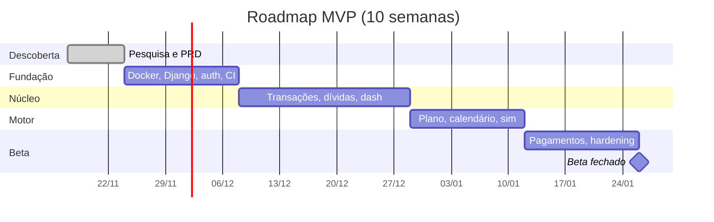
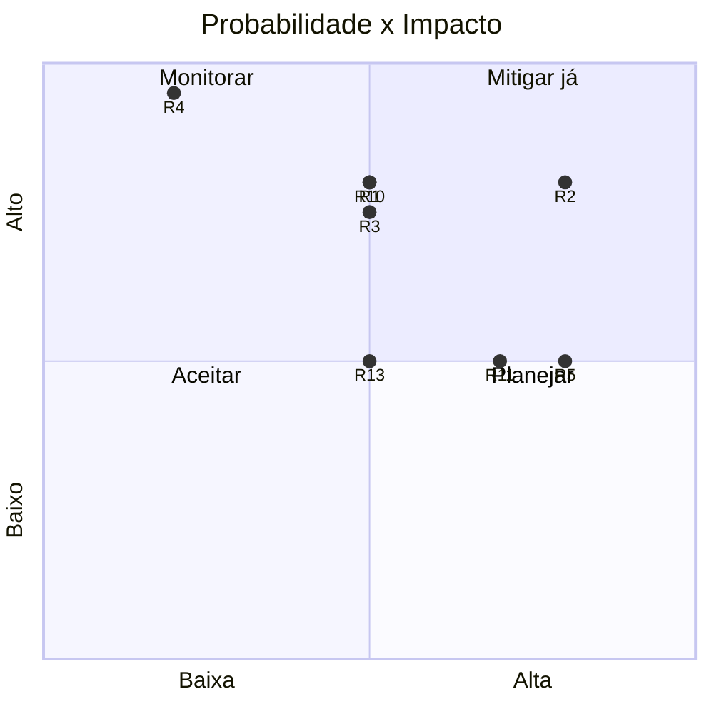

# 09 — Roadmap, Backlog e Riscos

**Objetivo:** transformar o escopo em um plano de execução priorizado, com
fases, estimativas, critérios de saída e riscos gerenciados.

**Premissa de capacidade:** 1 dev full-stack (1 FTE) + design/QA parciais.
Ajustar datas proporcionalmente à equipe.

---

## 1. Fases

> **Status em 2026-11-19:** Fases 0–3 concluídas; Fase 4 implementada. Beta fechado é a próxima ação operacional.

| Fase | Duração | Objetivo | Critério de saída | Status |
|------|---------|----------|-------------------|--------|
| **0. Descoberta** | 1 semana | Validar problema e escopo | PRD, arquitetura e requisitos aprovados | ✅ |
| **1. Fundação** | 2 semanas | Base técnica segura | `compose up`, auth, perfil, CI verde | ✅ |
| **2. Núcleo financeiro** | 3 semanas | Registro e diagnóstico | CRUD completo, dashboard, testes | ✅ |
| **3. Motor e plano** | 2 semanas | Decisão e projeção | Casos de ouro verdes, comparação, simulador | ✅ |
| **4. Execução e beta** | 2 semanas | Ação e confiabilidade | Pagamentos, exportação, hardening, beta | ✅ implementado; beta ⏳ |

**Total MVP:** ~10 semanas · **Beta público:** +2 semanas de correções.

---

## 2. Backlog priorizado

### 2.1 Épicos

| ID | Épico | Valor | Esforço | Fase |
|----|-------|-------|---------|------|
| E1 | Fundação e autenticação | Alto | M | 1 |
| E2 | Perfil financeiro e onboarding | Alto | S | 1 |
| E3 | Transações e categorias | Alto | M | 2 |
| E4 | Dívidas e pagamentos | Alto | M | 2 |
| E5 | Dashboard e diagnóstico | Alto | M | 2 |
| E6 | Motor e plano | Muito alto | L | 3 |
| E7 | Comparação e simulador | Alto | M | 3 |
| E8 | Execução e recálculo | Alto | M | 4 |
| E9 | Relatórios e exportação | Médio | S | 4 |
| E10 | Segurança, LGPD e hardening | Alto | M | 4 |
| E11 | Importação CSV/OFX | Médio | M | P1 |
| E12 | Workspace familiar | Médio | L | P1/P2 |
| E13 | Open Finance | Alto (longo prazo) | XL | P2 |

### 2.2 RICE (priorização)

> Fórmula: `(Reach × Impact × Confidence) / Effort`
> Escalas: Reach em pontos de 0–100 (cobertura relativa); Impact 3/2/1/0,5/0,25;
> Confidence 100/80/50%; Effort em pessoa-mês. Os valores são **relativos** e
> servem para ordenar, não como previsão absoluta.

| Item | Reach | Impact | Conf. | Effort | RICE | Decisão |
|------|-------|--------|-------|--------|------|---------|
| Auth + perfil | 100% | 3 | 100% | 0,5 | 600 | Fazer |
| Transações | 100% | 3 | 100% | 1,0 | 300 | Fazer |
| Dívidas | 100% | 3 | 100% | 1,0 | 300 | Fazer |
| Dashboard | 100% | 2 | 100% | 0,5 | 400 | Fazer |
| Motor de plano | 100% | 3 | 80% | 2,0 | 120 | Fazer |
| Simulador | 70% | 2 | 80% | 1,0 | 112 | Fazer |
| Pagamentos/recálculo | 80% | 2 | 100% | 1,0 | 160 | Fazer |
| Exportação | 50% | 1 | 100% | 0,3 | 167 | Fazer |
| Importação CSV/OFX | 60% | 2 | 80% | 1,5 | 64 | P1 |
| Lembretes e-mail | 50% | 1 | 100% | 0,5 | 100 | P1 |
| Workspace familiar | 30% | 2 | 50% | 2,5 | 12 | P1/P2 |
| Open Finance | 60% | 3 | 50% | 5,0 | 18 | P2 |
| IA assistiva | 30% | 2 | 50% | 2,0 | 15 | P2 |

**Leitura:** o núcleo (auth, transações, dívidas, dashboard, motor) domina o
valor. Importação e Open Finance reduzem fricção, mas não são pré-requisitos.

### 2.3 MoSCoW

| Must (MVP) | Should (P1) | Could (P2) | Won't |
|------------|-------------|------------|-------|
| Auth e perfil | Importação CSV/OFX | Workspace familiar | Investimentos |
| Transações | Lembretes e-mail | Open Finance | IRPF |
| Dívidas | Relatório PDF | PWA offline | Contabilidade |
| Dashboard | Orçamento por categoria | IA assistiva | Crédito/pagamentos |
| Motor e plano | Multimoeda | App nativo | Consultoria |
| Comparação | Metas de poupança | Notificações push | |
| Simulador | Aderência ao plano | Auditoria do titular | |
| Pagamentos | | | |
| Exportação | | | |
| Hardening/LGPD | | | |

---

## 3. Detalhamento por fase

### Fase 1 — Fundação (2 semanas)

**Entregas**

- Repositório, `pyproject.toml`, lint/format, pre-commit.
- Dockerfile multi-stage, compose dev/prod, Nginx, healthchecks.
- Django settings por ambiente, `.env.example`, `SECRET_KEY` seguro.
- App `accounts`: User, Profile, cadastro, login, logout, recuperação.
- Design tokens (Material 3 + vidro), layout base (Tailwind), navegação,
  componentes core (`@material/web`) e estados vazios.
- Página de referência visual (style guide) com light/dark e fallback sólido.
- CI: lint, testes, build, `check --deploy`.
- Seed de categorias padrão.

**Critérios de saída**

- `docker compose up` sobe web + db + redis.
- Login/cadastro/logout funcionando.
- Testes verdes; cobertura inicial ≥ 60%.
- Nenhum segredo no Git.

### Fase 2 — Núcleo financeiro (3 semanas)

**Entregas**

- CRUD de categorias, contas.
- Transações à vista, parceladas e recorrentes.
- Filtros, busca e paginação.
- CRUD de dívidas e histórico de pagamentos.
- Dashboard: saldo, dívida total, comprometimento, DTI, alertas.
- Onboarding wizard (renda, essenciais, primeira dívida).
- Testes de isolamento por usuário.

**Critérios de saída**

- Usuário consegue registrar sua situação completa em < 10 min.
- Dashboard reflete os dados corretamente.
- Recorrência não duplica; parcelas fecham o total.
- Cobertura ≥ 75%.

### Fase 3 — Motor e plano (2 semanas)

**Entregas**

- Pacote `engine` puro (tipos, fórmulas, ordenação, simulação).
- Casos de ouro e testes de propriedade.
- `PlanService`: montar input, persistir plano, snapshot, `engine_version`.
- Tela de plano: ordem, justificativas, calendário, totais.
- Comparação avalanche/snowball/híbrida.
- Simulador: corte, renda extra, conservador.
- Avisos e estados de inviabilidade.

**Critérios de saída**

- Casos de ouro verdes (doc 06).
- Performance < 300 ms (20 dívidas × 60 meses).
- Plano reproduzível pelo snapshot.
- Comparação e recomendação explicadas.

### Fase 4 — Execução e beta (2 semanas)

**Entregas**

- Registro de pagamentos idempotente e recálculo.
- Marcar parcela como paga.
- Exportação CSV/JSON; relatório mensal.
- Preferências de notificação e lembrete de vencimento (e-mail).
- Hardening: CSRF, rate limit, CSP, logs sem PII, backups.
- Política de privacidade, termos, tela "Meus dados".
- Testes E2E dos fluxos críticos.
- Beta fechado (10–20 usuários).

**Critérios de saída**

- Fluxo completo: onboarding → plano → pagamento → recálculo.
- Exportação e exclusão funcionando.
- Nenhum achado crítico de segurança.
- Feedback do beta coletado e priorizado.

---

## 4. Sprints sugeridas (2 semanas cada)

| Sprint | Foco | Entregáveis |
|--------|------|-------------|
| S1 | Fundação | Docker, auth, perfil, CI, layout |
| S2 | Núcleo I | Categorias, contas, transações, recorrência |
| S3 | Núcleo II | Dívidas, pagamentos, dashboard, onboarding |
| S4 | Motor | Engine, plano, calendário, comparação |
| S5 | Execução/Beta | Simulador, exportação, hardening, beta |

**Buffer:** 20% da capacidade por sprint para imprevistos e dívida técnica.

---

## 5. Dependências

| Dependência | Tipo | Impacto | Mitigação |
|-------------|------|---------|-----------|
| Definição de nome/identidade | Marca | Beta | Usar nome de trabalho |
| Validação financeira das fórmulas | Especialista | Motor | Casos de ouro + revisão |
| Domínio e TLS | Infra | Deploy | Let's Encrypt |
| Servidor de e-mail | Infra | Recuperação/lembretes | SMTP transacional |
| Política de privacidade/termos | Jurídico | Lançamento | Modelo + revisão |
| Pentest | Segurança | Beta público | Agendar na fase 4 |
| Feedback de usuários | Produto | P1 | Beta fechado |

---

## 6. Riscos e mitigações

| # | Risco | Prob. | Impacto | Mitigação | Dono |
|---|-------|-------|---------|-----------|------|
| R1 | Erro de cálculo financeiro | Média | Alto | Engine puro, casos de ouro, revisão, reconciliação | Eng |
| R2 | Baixa adesão ao lançamento | Alta | Alto | Onboarding, 3 toques, importação P1, lembretes | Produto |
| R3 | Plano inviável frustra usuário | Média | Alto | Diagnóstico honesto + alternativas | Produto |
| R4 | Vazamento de dados | Baixa | Crítico | Controles doc 08, pentest, monitoramento | Security |
| R5 | Escopo inflar | Alta | Médio | MoSCoW, freeze, revisão semanal | Produto |
| R6 | Dependência de Open Finance | Média | Médio | Fora do MVP; adapter futuro | Eng |
| R7 | Interpretação como consultoria | Média | Médio | Disclaimers, linguagem, limites | Produto/Jurídico |
| R8 | Migração/backup falha | Baixa | Alto | Teste de restore mensal | Ops |
| R9 | Performance degradar | Média | Médio | Índices, paginação, medição | Eng |
| R10 | Dependência vulnerável | Média | Alto | Lockfile, pip-audit, scan de imagem | Eng |
| R11 | Usuário não entende juros | Alta | Médio | Educação contextual, CET, exemplos | Produto |
| R12 | Renda variável mal modelada | Média | Médio | Cenário conservador, média móvel | Produto |
| R13 | Vidro prejudicar contraste/performance | Média | Médio | Limite de camadas, fallback sólido, teste em device modesto, QA de contraste | Design/Eng |

### 6.1 Matriz de risco

---

## 7. Métricas e experimentos

### 7.1 Métricas do MVP

| Métrica | Meta | Instrumentação |
|---------|------|----------------|
| Ativação (7 dias) | ≥ 50% | Eventos opt-in |
| Plano gerado | ≥ 60% | Contagem interna |
| Aderência | ≥ 40% | Pagamentos vs. plano |
| Redução de dívida (90d) | ≥ 10% | Coorte |
| Retenção W4 | ≥ 35% | Eventos |
| NPS | ≥ 40 | Pesquisa in-app |

### 7.2 Experimentos (pós-MVP)

1. **Onboarding curto vs. completo:** medir ativação e conclusão.
2. **Híbrida como padrão vs. escolha livre:** medir adesão e juros economizados.
3. **Lembrete D-3 vs. D-1:** medir pagamento no prazo.
4. **Linguagem ("você pode" vs. "você deve"):** medir retenção e NPS.
5. **Mostrar juros economizados:** medir adesão ao plano.

---

## 8. Definition of Ready (DoR)

Uma história entra em sprint se:

- [ ] Tem persona, objetivo e valor claros.
- [ ] Critérios de aceite testáveis.
- [ ] Regras de negócio referenciadas (doc 03/06).
- [ ] Protótipo/wireframe quando afeta UX.
- [ ] Dependências identificadas.
- [ ] Estimativa e prioridade definidas.
- [ ] Sem bloqueio de decisão aberta.

---

## 9. Definition of Done (DoD)

- [ ] Critérios de aceite implementados.
- [ ] Testes unitários e de integração verdes.
- [ ] Cobertura não caiu; motor ≥ 90%.
- [ ] Revisão de código aprovada.
- [ ] Acessibilidade verificada (teclado, contraste, labels, foco visível).
- [ ] Design system aplicado: tokens, Material 3, vidro com fallback e
      `prefers-reduced-motion/transparency`; sem hex avulso.
- [ ] Sem PII em logs; autorização testada.
- [ ] Documentação atualizada (se regra mudou).
- [ ] Deploy em staging validado.
- [ ] Métrica/evento instrumentado (se aplicável).

---

## 10. Checklist de lançamento (beta)

### Produto
- [ ] Fluxos críticos testados ponta a ponta.
- [ ] Textos revisados (sem juros/culpa).
- [ ] Disclaimers visíveis.
- [ ] Estado vazio e erros amigáveis.
- [ ] Onboarding em < 10 min.

### Engenharia
- [ ] CI verde; `check --deploy` limpo.
- [ ] Migrations aplicadas e reversíveis.
- [ ] Backups e restore testados.
- [ ] Healthchecks e alertas.
- [ ] Logs sem PII.
- [ ] Performance dentro das metas.

### Segurança/LGPD
- [ ] Pentest sem achados críticos.
- [ ] Política de privacidade e termos publicados.
- [ ] Exportação/exclusão funcionando.
- [ ] Consentimentos registrados.
- [ ] Encarregado e canal definidos.
- [ ] Incident response documentado.

### Operação
- [ ] Domínio e TLS.
- [ ] Monitoramento 24/7 (ou alertas).
- [ ] Runbook de restore.
- [ ] Contatos de emergência.
- [ ] Plano de suporte ao beta.

---

## 11. Pós-MVP (P1/P2)

### P1 — Próximos 3 meses

- Importação CSV/OFX.
- Lembretes e resumo semanal.
- Orçamento por categoria (envelopes).
- Relatório PDF.
- Metas de poupança e reserva.
- MFA e tokens de API.
- Aderência e histórico de progresso.

### P2 — 6–12 meses

- Workspace familiar com papéis e privacidade.
- Open Finance via agregador.
- PWA offline.
- Notificações push.
- IA assistiva (opt-in, dados minimizados).
- Multimoeda.
- Benchmark anônimo (opt-in).

**Critério para avançar:** métricas do MVP estáveis e ausência de dívida técnica
crítica. Não iniciar P2 antes de fechar o ciclo de feedback do beta.

---

## 12. Capacidade e cronograma

| Fase | Semanas | Pessoa-semanas (aprox.) |
|------|---------|-------------------------|
| 0 Descoberta | 1 | 1 |
| 1 Fundação | 2 | 2 |
| 2 Núcleo | 3 | 3 |
| 3 Motor | 2 | 2 |
| 4 Execução/Beta | 2 | 2 |
| Buffer (20%) | 2 | 2 |
| **Total** | **12** | **12** |

Com 2 devs, o calendário pode cair para ~6–7 semanas, mantendo os mesmos
critérios de saída e revisões.
