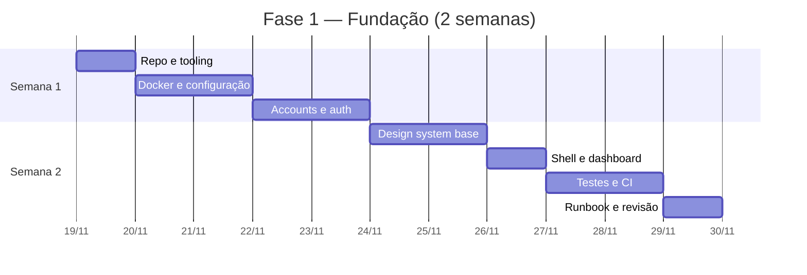

# 12 — Plano de Execução do Projeto

**Objetivo:** transformar a documentação de produto em um plano executável,
com fases, tarefas, dependências, critérios de aceite e registro de progresso.

**Status geral:** Fase 4 implementada — beta operacional pronto para iniciar
**Última atualização:** 2026-11-19
**Responsável:** Engenharia/Produto
**Referências:** [PRD](PRD.md) · [Requisitos](03-requisitos-e-regras-de-negocio.md) ·
[Arquitetura](04-arquitetura-tecnica.md) · [Motor](06-motor-plano-regularizacao.md) ·
[Design System](11-design-system-material-glass.md)

---

## 1. Estratégia de execução

1. **Walking skeleton primeiro.** Um fluxo mínimo ponta a ponta (Docker → Django →
   PostgreSQL → tela) antes de aprofundar funcionalidades.
2. **Fatias verticais.** Cada entrega atravessa banco, domínio, API/UI e teste.
3. **Qualidade contínua.** Lint, testes e `check --deploy` desde o primeiro commit.
4. **Design system desde o início.** Tokens Material 3 + vidro antes das telas.
5. **Sem dados reais em dev.** Seeds e fixtures anonimizadas.
6. **Decisões registradas.** Mudanças estruturais viram ADR.
7. **Buffer de 20%.** Imprevistos e dívida técnica têm espaço no cronograma.

---

## 2. Premissas e restrições

| Item | Premissa |
|------|----------|
| Equipe | 1 dev full-stack (1 FTE) + design/QA parciais |
| Stack | Python 3.12, Django 5.2 LTS, PostgreSQL 16, Redis 7 |
| UI | Material Design 3 + Glassmorphism, HTMX, Tailwind |
| Infra | Docker Compose em 1 host; Nginx + Gunicorn |
| Prazo MVP | ~10 semanas + 2 de buffer |
| Ambiente local | Docker e Docker Compose disponíveis |
| Dados | Nenhum dado real em dev/staging |
| Qualidade | Cobertura ≥ 80% global; motor ≥ 90% |

> **Nota de ambiente:** o host de desenvolvimento pode ter versões mais novas
> (ex.: Python 3.14/Django 6). O Docker fixa as versões de produção; testes
> locais devem usar o container para evitar divergência.

---

## 3. Estrutura analítica do trabalho (WBS)

```mermaid
flowchart TB
    P[Projeto] --> F0[Fase 0 · Descoberta]
    P --> F1[Fase 1 · Fundação]
    P --> F2[Fase 2 · Núcleo Financeiro]
    P --> F3[Fase 3 · Motor e Plano]
    P --> F4[Fase 4 · Execução e Beta]
    P --> F5[Pós-MVP · P1/P2]

    F1 --> F1a[Repo + Tooling]
    F1 --> F1b[Docker + Config]
    F1 --> F1c[Accounts + Auth]
    F1 --> F1d[Design System Base]
    F1 --> F1e[Dashboard Shell]
    F1 --> F1f[Testes + CI]
    F1 --> F1g[Runbook]

    F2 --> F2a[Categorias/Contas]
    F2 --> F2b[Transações]
    F2 --> F2c[Dívidas/Pagamentos]
    F2 --> F2d[Dashboard real]
    F2 --> F2e[Onboarding]

    F3 --> F3a[Engine puro]
    F3 --> F3b[PlanService]
    F3 --> F3c[Plano/Calendário]
    F3 --> F3d[Comparação]
    F3 --> F3e[Simulador]

    F4 --> F4a[Pagamentos/Recálculo]
    F4 --> F4b[Relatórios/Export]
    F4 --> F4c[Hardening/LGPD]
    F4 --> F4d[Beta fechado]
```



---

## 4. Fases, tarefas e critérios de aceite

### Fase 0 — Descoberta (concluída)

| ID | Tarefa | Status | Evidência |
|----|--------|--------|-----------|
| F0.1 | Pesquisa e benchmark | ✅ | `01-pesquisa-e-benchmark.md` |
| F0.2 | Personas e jornadas | ✅ | `02-personas-e-jornadas.md` |
| F0.3 | Requisitos e regras | ✅ | `03-requisitos-e-regras-de-negocio.md` |
| F0.4 | Arquitetura e dados | ✅ | `04`, `05` |
| F0.5 | Motor de regularização | ✅ | `06` |
| F0.6 | API e segurança | ✅ | `07`, `08` |
| F0.7 | Roadmap e ADRs | ✅ | `09`, `10` |
| F0.8 | Design system | ✅ | `11` |

**Critério de saída:** documentação revisada e sem decisões bloqueantes para a Fase 1.

---

### Fase 1 — Fundação (em execução)

**Objetivo:** ter um sistema executável, seguro e testado, com autenticação,
perfil financeiro, shell visual e CI.

| ID | Tarefa | Depende de | Status |
|----|--------|------------|--------|
| F1.1 | Estrutura do repositório e tooling | — | ✅ |
| F1.2 | Docker + Compose + Nginx + entrypoint | F1.1 | ✅ |
| F1.3 | Configuração Django (base/dev/prod) | F1.2 | ✅ |
| F1.4 | App `accounts`: User, Profile, Consent | F1.3 | ✅ |
| F1.5 | Fluxos de auth (registro, login, logout, reset) | F1.4 | ✅ |
| F1.6 | Design system base (tokens + glass + Material) | F1.3 | ✅ |
| F1.7 | Shell, dashboard placeholder e style guide | F1.6 | ✅ |
| F1.8 | Healthchecks e utilitários (money, request id) | F1.3 | ✅ |
| F1.9 | Testes unitários/integração da fundação | F1.4–F1.8 | ✅ |
| F1.10 | CI (lint, testes, `check --deploy`) | F1.9 | ✅ |
| F1.11 | Runbook e atualização da documentação | F1.2–F1.10 | ✅ |

**Critérios de aceite**

- [ ] `docker compose up` sobe `web`, `db` e `redis` com healthchecks.
- [ ] Cadastro, login, logout e recuperação de senha funcionam.
- [ ] Perfil financeiro salva renda, essenciais e mínimo existencial.
- [ ] Dashboard mostra saldo livre e estado vazio quando não há dados.
- [ ] Style guide demonstra tokens, vidro, light/dark e fallback.
- [ ] Testes verdes; cobertura inicial ≥ 60%.
- [ ] `python manage.py check --deploy` sem erros críticos.
- [ ] Nenhum segredo versionado.
- [ ] CI configurado e reproduzível localmente.

---

### Fase 2 — Núcleo financeiro (concluída)

| ID | Tarefa | Depende de | Estimativa | Status |
|----|--------|------------|------------|--------|
| F2.1 | Categorias e contas (CRUD, seeds) | F1 | 2 d | ✅ |
| F2.2 | Transações à vista e filtros | F2.1 | 3 d | ✅ |
| F2.3 | Parcelamento e recorrência idempotente | F2.2 | 3 d | ✅ |
| F2.4 | Dívidas e histórico de pagamentos | F2.1 | 3 d | ✅ |
| F2.5 | Onboarding completo | F2.1–F2.4 | 2 d | ✅ |
| F2.6 | Dashboard com indicadores reais | F2.2–F2.4 | 3 d | ✅ |
| F2.7 | Alertas de risco (DTI, amortização negativa) | F2.6 | 2 d | ✅ |
| F2.8 | Testes de isolamento e integração | F2.1–F2.7 | contínuo | ✅ (44 testes) |

**Critério de saída**

- [x] Usuário registra categorias, contas, transações, parcelamentos, recorrências e dívidas.
- [x] Dashboard usa dados reais (renda, despesas, dívida total, comprometimento e disponível).
- [x] Recorrência é idempotente (unique por competência) e materializada por comando/task.
- [x] Parcelas fecham exatamente o valor total (ajuste na última).
- [x] Pagamento de dívida separa juros/principal e é idempotente.
- [x] Acesso cruzado entre usuários retorna 404.

---

### Fase 3 — Motor e plano (concluída)

| ID | Tarefa | Depende de | Estimativa | Status |
|----|--------|------------|------------|--------|
| F3.1 | Pacote `engine` puro (tipos, fórmulas) | F2 | 3 d | ✅ |
| F3.2 | Ordenações avalanche/snowball/híbrida | F3.1 | 1 d | ✅ |
| F3.3 | Simulação mensal + casos de ouro | F3.1 | 3 d | ✅ |
| F3.4 | `PlanService` + snapshot + versão | F3.2, F3.3 | 2 d | ✅ |
| F3.5 | Tela de plano e calendário | F3.4 | 3 d | ✅ |
| F3.6 | Comparação de estratégias | F3.4 | 2 d | ✅ |
| F3.7 | Simulador (corte, extra, renegociação) | F3.4 | 3 d | ✅ |
| F3.8 | Avisos de inviabilidade e ética | F3.4 | 1 d | ✅ |

**Critério de saída**

- [x] Casos de ouro da doc 06 verdes (uma, três e quatro dívidas; textbook; bordas).
- [x] Plano reproduzível via `input_snapshot` + `engine_version`.
- [x] Comparação avalanche/snowball/híbrida com recomendação explicada.
- [x] Simulador de corte, renda extra, renegociação e cenário conservador.
- [x] Avisos de inviabilidade, amortização negativa, prazo e dívida crescente.
- [x] Performance do motor < 300 ms para 20 dívidas × 60 meses.

---

### Fase 4 — Execução e beta (implementada)

| ID | Tarefa | Depende de | Estimativa | Status |
|----|--------|------------|------------|--------|
| F4.1 | Aderência ao plano e pagamento de parcelas | F3 | 2 d | ✅ |
| F4.2 | Recálculo e status `stale` | F4.1 | 1 d | ✅ |
| F4.3 | Relatório mensal e exportação CSV/JSON | F3 | 2 d | ✅ |
| F4.4 | Lembretes por e-mail (opt-in) | F1 | 2 d | ✅ |
| F4.5 | Hardening (CSRF, CSP, rate limit, logs, auditoria) | F1–F4 | 3 d | ✅ |
| F4.6 | Política de privacidade, termos e "Meus dados" | F4.5 | 2 d | ✅ |
| F4.7 | Testes de fluxo completo e integração | F4.1–F4.6 | 3 d | ✅ (87 testes) |
| F4.8 | Auditoria estática/dependências e correções | F4.5 | 3 d | ✅ (bandit + pip-audit) |
| F4.9 | Beta fechado (10–20 usuários) | F4.1–F4.8 | 5 d | ⏳ pronto para iniciar |

**Critério de saída**

- [x] Aderência: marcar parcela planejada como paga, idempotente e com progresso.
- [x] Relatório mensal, exportação JSON completa e CSV de transações.
- [x] Notificações in-app e e-mails de vencimento com opt-in e deduplicação.
- [x] Página "Meus dados" com exportação e exclusão de conta auditada.
- [x] Rate limit em login/registro/reset, CSP e headers de segurança.
- [x] Auditoria de login, exportação, exclusão, plano e pagamentos.
- [ ] Beta com 10–20 usuários (depende de recrutamento e operação).

---

### Pós-MVP (P1/P2)

- Importação CSV/OFX.
- Orçamento por categoria/envelopes.
- Workspace familiar.
- Open Finance.
- PWA offline e notificações push.
- IA assistiva (opt-in).
- Multimoeda.

---

## 5. Sequência de execução da Fase 1



**Ordem prática:**

1. Estrutura + tooling.
2. Docker/compose + settings.
3. Models/migrations de accounts.
4. Auth + perfil.
5. Tokens + shell + style guide.
6. Dashboard placeholder.
7. Testes + CI.
8. Runbook.

---

## 6. Ambiente e comandos

### 6.1 Desenvolvimento

```bash
cp .env.example .env
docker compose -f compose.yaml -f compose.dev.yaml up --build
docker compose exec web python manage.py migrate
docker compose exec web python manage.py createsuperuser
```

Acesse `http://localhost:8000`. E-mails de dev em `http://localhost:8025` (Mailpit).

### 6.2 Testes e qualidade

```bash
docker compose exec web pytest
docker compose exec web ruff check .
docker compose exec web black --check .
docker compose exec web python manage.py check --deploy
```

### 6.3 Produção

```bash
docker compose build
docker compose run --rm web python manage.py migrate --noinput
docker compose up -d
```

Checklist completo em [04-arquitetura-tecnica.md](04-arquitetura-tecnica.md).

---

## 7. Quality gates

| Gate | Critério | Bloqueia merge? |
|------|----------|-----------------|
| G1 | Lint/format sem erros | Sim |
| G2 | Testes verdes | Sim |
| G3 | Cobertura ≥ 80% (motor ≥ 90%) | Sim (a partir da Fase 3) |
| G4 | `check --deploy` sem crítico | Sim |
| G5 | Sem segredo/PII em log | Sim |
| G6 | Acessibilidade básica (teclado/contraste) | Sim |
| G7 | Design tokens (sem hex avulso) | Sim |
| G8 | Migração revisada/reversível | Sim |
| G9 | Documentação atualizada | Sim |

---

## 8. Riscos da execução

| Risco | Impacto | Mitigação |
|-------|---------|-----------|
| Divergência de versões host vs. container | Médio | Testar sempre no container; fixar versões |
| `backdrop-filter` lento em devices modestos | Médio | Limite de camadas, fallback, teste real |
| Auth customizada com bugs | Alto | Usar classes do Django, testes de fluxo |
| Escopo inflar | Alto | Freeze da Fase 1; P1/P2 fora |
| Falta de e-mail em dev | Baixo | Mailpit |
| Migrations destrutivas | Alto | Revisão + backup + plano de rollback |
| Cobertura baixa no início | Médio | Meta 60% na Fase 1, 80% até Fase 3 |

---

## 9. Definition of Done (por tarefa)

- [ ] Implementação + validação server-side.
- [ ] Testes unitários/integração.
- [ ] Lint/format.
- [ ] Sem segredo/PII em log.
- [ ] Acessibilidade básica.
- [ ] Design tokens aplicados.
- [ ] Documentação/runbook atualizados.
- [ ] Revisão de código.

---

## 10. Registro de execução

| Data | Fase | Entrega | Status | Observações |
|------|------|---------|--------|-------------|
| 2026-11-19 | 0 | Documentação completa | ✅ | 14 documentos em `Docs/` |
| 2026-11-19 | 1 | Estrutura, Docker, Django, auth, design base, testes, CI | ✅ | Stack dev validada: `/healthz`, `/readyz`, landing e style guide 200; worker/beat conectados ao Redis; 21 testes verdes; `ruff`/`black`/`check --deploy` limpos. |
| 2026-11-19 | 2 | Categorias, contas, transações, parcelamento, recorrência, dívidas, pagamentos, dashboard e onboarding | ✅ | 44 testes verdes; fluxo real validado no Docker; task `materialize_recurrences` registrada no worker/beat. |
| 2026-11-19 | 3 | Motor, plano, calendário, comparação, simulador e integração no dashboard | ✅ | 72 testes verdes; casos de ouro conferem com a doc 06; fluxo real de geração, comparação, simulação e aplicação validado no Docker. |
| 2026-11-19 | 4 | Aderência, relatórios/exportação, notificações, LGPD, hardening e seed de demo | ✅ | 87 testes verdes; `bandit` e `pip-audit` limpos; fluxo real de relatório, exportação, notificações e headers validado no Docker. |

---

## 11. Status da Fase 1 (executado)

| Item | Evidência |
|------|-----------|
| Estrutura do projeto | `manage.py`, `src/config`, `src/apps`, `tests/` |
| Docker | `docker/Dockerfile`, `docker/Dockerfile.dev`, `compose.yaml`, `compose.dev.yaml`, `compose.prod.yaml`, `docker/nginx.conf` |
| Configuração | `src/config/settings/{base,dev,prod}.py`, `.env.example` |
| Accounts | `src/apps/accounts/models.py`, migrations, forms, views, urls |
| Auth | registro, login, logout, reset (Django), templates |
| Perfil | formulário de perfil financeiro + saúde financeira |
| Design | `src/static/css/tokens.css`, `src/static/css/app.css`, shell, style guide |
| Material 3 | `package.json` com `@material/web`; bundle Vite gerado e validado; fallback CSS nativo |
| Health | `/healthz`, `/readyz` |
| Testes | `tests/` com pytest-django |
| CI | `.github/workflows/ci.yml` |
| Runbook | seção 6 + `Docs/README.md` |

**Pendências conhecidas da Fase 1**

- Substituir `SECRET_KEY` e credenciais no `.env` de produção.
- Configurar SMTP real (Mailpit apenas em dev).
- Em produção, configurar TLS/Let's Encrypt e o `compose.prod.yaml`.
- Adicionar smoke test de registro/login no CI (hoje coberto por testes Django).

### 11.1 Status da Fase 2 (executado)

| Item | Evidência |
|------|-----------|
| Categorias | `src/apps/finance/models.py`, seeds automáticos, CRUD e arquivamento |
| Contas | CRUD, arquivamento e conta principal criada no cadastro |
| Transações | CRUD, filtros por período/tipo/status/categoria, paginação e soft delete |
| Parcelamento | `create_installment_plan`, ajuste de centavos na última parcela |
| Recorrência | `create_recurrence`, materialização idempotente, comando e task Celery |
| Dívidas | CRUD, taxas mensal/anual, status e alerta de amortização negativa |
| Pagamentos | `record_payment`, separação juros/principal, idempotência e histórico |
| Dashboard | `apps/core/services.py` com renda, despesas, dívida, comprometimento, alertas e passos |
| Onboarding | `/comecar/` com progresso e CTAs |
| Isolamento | todas as consultas por usuário; testes de acesso cruzado retornam 404 |
| Testes | 44 testes verdes (`manage.py test` e `pytest`) |

**Pendências conhecidas da Fase 2**

- Workspace familiar e importação CSV/OFX continuam P1.
- Categorização automática de transações não faz parte do MVP.
- A integração visual completa dos componentes Material Web fica para a Fase 3/4.

---

### 11.2 Status da Fase 3 (executado)

| Item | Evidência |
|------|-----------|
| Motor puro | `src/apps/plans/engine/` sem dependência de Django |
| Fórmulas | conversão mensal/anual, PMT e taxa implícita em `engine/rates.py` |
| Ordenações | avalanche, snowball e híbrida com quick wins limitados |
| Simulação | juros capitalizados, mínimos, excedente, rollover e reconciliação |
| Casos de ouro | `tests/test_engine.py` (14 testes, números da doc 06) |
| Persistência | `Plan`, `PlanItem`, `PlanSchedule`, snapshot e `engine_version` |
| Stale | alterações em dívida/perfil marcam o plano ativo como desatualizado |
| Plano/calendário | `/plano/`, detalhe, paginação e totais |
| Comparação | `/plano/comparar/` com recomendação |
| Simulador | `/plano/simulador/` + aplicação de cenário |
| Integração | card do plano no dashboard e passo no onboarding |
| Testes totais | 72 verdes |

**Dívidas técnicas conhecidas**

- Multiusuário familiar/workspace permanece P1.
- Importação CSV/OFX permanece P1.
- Open Finance permanece P2.
- O plano aplicado a partir de simulação é uma projeção rotulada; recalcular mantém o cenário até gerar um novo plano base.
- Smoke test HTTP no CI pode ser adicionado junto do E2E (Fase 4).

---

### 11.3 Status da Fase 4 (implementado)

| Item | Evidência |
|------|-----------|
| Aderência | `PlanPayment`, `mark_schedule_paid`, progresso no plano/dashboard |
| Relatório | `/relatorios/` com resumo, categorias, dívidas e plano |
| Exportação | JSON completo e CSV de transações com proteção contra CSV injection |
| Notificações | preferências, in-app, e-mail, dedupe e task Celery diária |
| Meus dados | exportação, consentimentos e exclusão de conta |
| Auditoria | `AuditLog` para login, exportação, exclusão, plano e pagamentos |
| Hardening | CSP, Permissions-Policy, COOP, rate limit, cookies e admin restrito |
| Segurança | `bandit` sem achados e `pip-audit` sem vulnerabilidades conhecidas |
| Demo/beta | `seed_demo` + checklist em `13-runbook.md` |
| Testes | 87 verdes (`manage.py test` e `pytest`) |

**Pendências conhecidas da Fase 4**

- Beta fechado depende de recrutamento de 10–20 usuários e operação de suporte.
- PDF server-side não foi adicionado; o relatório tem impressão para PDF do navegador.
- E2E em navegador (Playwright) pode ser adicionado como próximo incremento.
- Pentest externo formal ainda deve ser contratado antes do beta público.

---

## 12. Próxima ação

Iniciar o **beta fechado** com o checklist do runbook:

1. Criar usuário demo/staging com `seed_demo`.
2. Convidar 10–20 usuários e acompanhar ativação, aderência e NPS.
3. Coletar feedback e priorizar correções.
4. Contratar pentest externo antes do beta público.
5. Planejar P1: importação CSV/OFX, workspace familiar e PDF.
