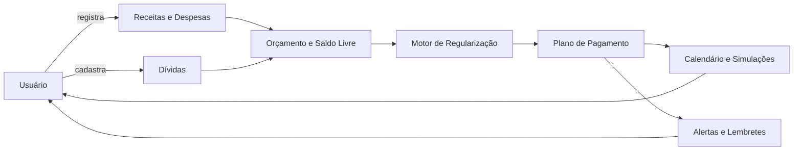
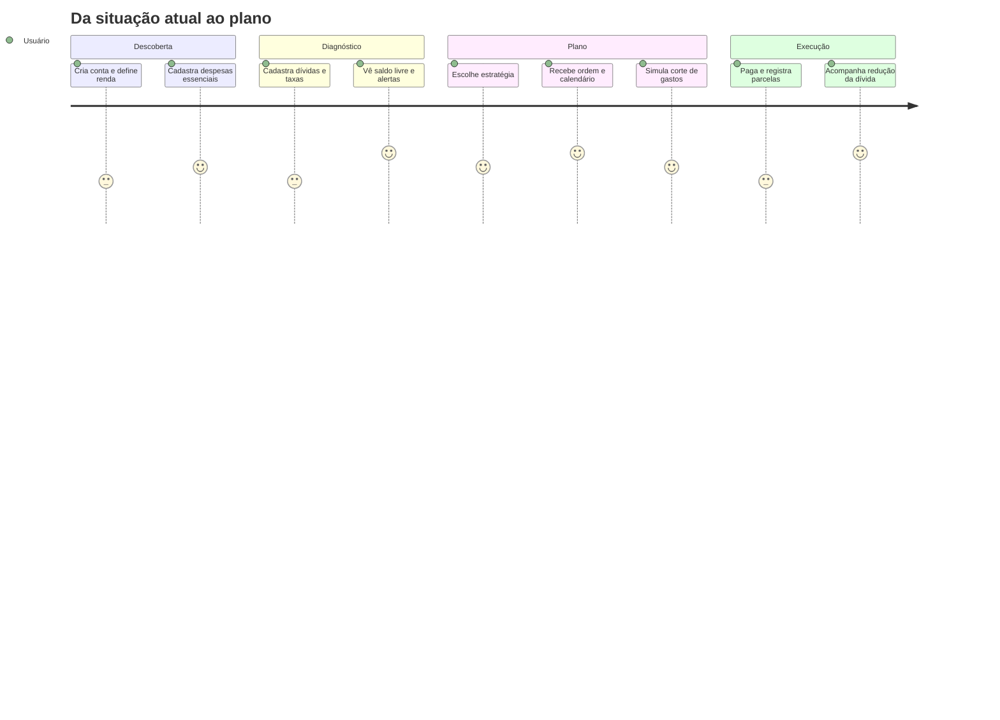
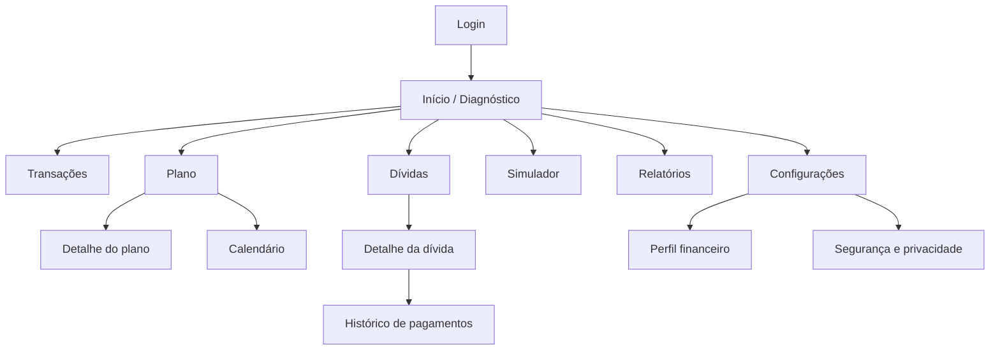
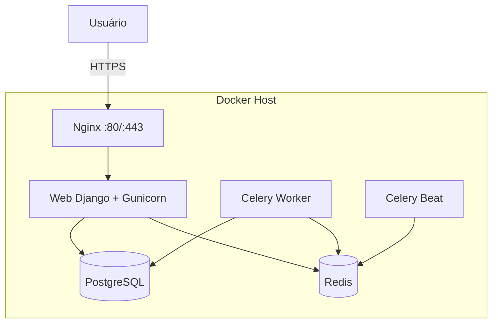

# PRD — Clareza Financeira

**Product Requirements Document**

| Campo | Valor |
|-------|-------|
| Produto | Clareza Financeira (nome de trabalho) |
| Versão do documento | 1.0 |
| Status | Em revisão |
| Autor | Produto |
| Data | 2026-11-19 |
| Stakeholders | Produto, Engenharia, Segurança, Operações |
| Documentos relacionados | [01 Pesquisa](01-pesquisa-e-benchmark.md) · [03 Requisitos](03-requisitos-e-regras-de-negocio.md) · [04 Arquitetura](04-arquitetura-tecnica.md) · [06 Motor](06-motor-plano-regularizacao.md) · [11 Design System](11-design-system-material-glass.md) |

---

## 1. Sumário executivo

### 1.1 Problema

O brasileiro médio tem acesso a extratos, aplicativos bancários e planilhas, mas
continua sem responder à pergunta que mais importa quando as contas não fecham:
**"o que eu pago primeiro e quanto posso pagar sem deixar de viver?"**

Ferramentas atuais priorizam *registro* (extrato, categorização, orçamento) e
deixam a *decisão* para o usuário. Quem está endividado normalmente:

- não sabe a taxa efetiva real das dívidas (cartão rotativo, cheque especial, parcelado);
- paga sempre a parcela mínima e não entende por que o saldo não cai;
- não separa despesas essenciais do que é negociável;
- não consegue comparar "pagar a menor dívida" vs. "pagar a mais cara";
- tem vergonha e evita planilhas complexas.

### 1.2 Solução

Um aplicativo web responsivo, operado em Docker, construído com Django e PostgreSQL,
que centraliza **receitas, despesas e dívidas por usuário** e gera um **plano de
regularização** explicável, com:

- ordem recomendada de pagamento;
- calendário mês a mês com juros e saldos projetados;
- data estimada de quitação;
- comparação entre estratégias (avalanche, snowball e híbrida);
- simulações de cenários (corte de gastos, renda extra, renegociação);
- alertas de risco e respeito ao mínimo existencial.

### 1.3 Impacto esperado

- **Para o usuário:** clareza sobre o próximo passo e redução do tempo até sair do vermelho.
- **Para a operação:** software self-hosted, de baixo custo, sem dependência de terceiros.
- **Para o negócio:** base para um produto de assinatura ou serviço de educação financeira
  (monetização fora do escopo do MVP).

### 1.4 Métricas de sucesso (MVP)

| Métrica | Definição | Meta inicial |
|---------|-----------|--------------|
| Ativação | % de cadastros que registram ≥ 3 transações e ≥ 1 dívida em 7 dias | ≥ 50% |
| Plano gerado | % de usuários ativos com plano de regularização gerado | ≥ 60% |
| Aderência ao plano | % de parcelas planejadas registradas como pagas no mês | ≥ 40% |
| Redução de dívida | Variação do saldo devedor total em 90 dias (coorte) | ≥ 10% |
| Retenção | Usuários ativos semanais que voltam na semana seguinte | ≥ 35% |
| NPS | Pesquisa in-app após 30 dias | ≥ 40 |

> Métricas coletadas **localmente**, com opt-in explícito. O produto deve funcionar
> plenamente sem telemetria.

---

## 2. Definição do problema

### 2.1 Quem é afetado

- **Pessoa física endividada**, renda de 1 a 5 salários mínimos, com 2 a 8 dívidas
  ativas (cartão, empréstimo pessoal, consignado, cheque especial, parcelado, crediário).
- **Famílias** que compartilham despesas e precisam de visão consolidada.
- **Autônomos e informais** com renda variável, que precisam de fluxo de caixa
  conservador e reserva de segurança.

### 2.2 Contexto e frequência

- A decisão de pagamento acontece **mensalmente**, no recebimento da renda.
- O estresse é recorrente e aumenta com cobranças, negativação e juros rotativos.
- A entrada de dados precisa ser **rápida** (mobile-first), senão o usuário abandona.

### 2.3 Causa raiz

1. **Assimetria de informação:** taxas e CET não são comparáveis na prática.
2. **Falta de método:** sem ordem de prioridade, o pagamento é emocional/aleatório.
3. **Ausência de orçamento realista:** o usuário não separa essencial de discricionário.
4. **Feedback tardio:** o extrato mostra o passado; não projeta consequências.
5. **Fricção:** ferramentas exigem disciplina de lançamento diário.

### 2.4 Custo de não resolver

- Juros compostos sobre juros (rotativo e cheque especial) podem consumir parcela
  relevante da renda.
- Negativação, restrição de crédito e impacto emocional/familiar.
- Decisões piores: quitar dívida barata enquanto a caríssima cresce.

### 2.5 Por que agora

- **Open Finance** no Brasil amadureceu (consentimentos e APIs padronizadas),
  viabilizando importação automática em uma fase futura.
- **Lei nº 14.181/2021** consolidou o conceito de superendividamento e mínimo existencial,
  criando vocabulário e base para planos de repactuação.
- Custo de infraestrutura self-hosted (Docker) e frameworks maduros (Django 5 + PostgreSQL 16)
  permitem entregar um MVP robusto com equipe pequena.
- Educação financeira e bem-estar financeiro ganharam espaço na agenda pública e privada.

---

## 3. Oportunidade e cenário competitivo

### 3.1 Referências de mercado

| Categoria | Exemplos | Força | Lacuna que exploramos |
|-----------|----------|-------|-----------------------|
| Orçamento/envelope | YNAB, Mobills, Organizze | Organização e categorização | Não prescrevem ordem de quitação nem simulam cenários |
| Agregadores bancários | GuiaBolso (encerrado), apps de banco | Importação e visão consolidada | Foco em transação; pouca ação sobre dívidas |
| Negociação de dívidas | Serasa Limpa Nome, birôs | Acordos e descontos | Não calculam capacidade real nem plano sustentável |
| Consultoria/planilhas | Consultores, planilhas | Personalização | Caro, manual, não escala |

**Posicionamento:** o "GPS da quitação" — entra com a situação atual, sai com o
próximo passo, o calendário e o impacto de cada escolha.

### 3.2 Tese de valor

> Se o usuário enxerga **quanto pode pagar** e **qual dívida atacar primeiro**,
> ele paga mais, com menos juros e menor chance de recaída.

### 3.3 Escopo geográfico e regulatório

- Brasil (pt-BR, BRL, fuso `America/Sao_Paulo`).
- LGPD aplicável desde o MVP.
- Sem operações de crédito, pagamento ou intermediação financeira: o app **não move dinheiro**.

---

## 4. Solução proposta

### 4.1 Visão geral



### 4.2 Capacidades-chave

1. **Perfil financeiro:** renda líquida, despesas essenciais, mínimo existencial,
   dependentes, moeda e preferências.
2. **Transações:** receitas e despesas com categoria, conta, recorrência, status e tags.
3. **Dívidas:** credor, tipo, saldo, taxa, parcela mínima, vencimento, status e histórico.
4. **Diagnóstico:** saldo livre, taxa de comprometimento, DTI, alertas de risco.
5. **Plano:** geração, versionamento, comparação de estratégias e calendário.
6. **Simulador:** cenários de corte, renda extra, renegociação e quitação antecipada.
7. **Acompanhamento:** registrar pagamentos, marcar parcelas, recalcular plano.
8. **Relatórios:** exportação CSV/PDF e resumo mensal.

### 4.3 Jornada principal (resumo)



### 4.4 Diferenciais

| Diferencial | Descrição | Defensabilidade |
|-------------|-----------|-----------------|
| Plano prescritivo | Ordem, valores e datas, não só gráficos | Algoritmo + UX explicável |
| Híbrido configurável | Quick wins sem perder eficiência | Regras transparentes e auditáveis |
| Mínimo existencial | Nenhum plano sacrifica o essencial | Alinhamento legal e ético |
| Simulação de cenários | "E se...?" com impacto em juros e prazo | Motor determinístico e testável |
| Privacidade | Self-hosted, exportação e exclusão | Arquitetura e governança |
| Explicabilidade | "Por que esta dívida primeiro?" | Confiança e educação |

---

## 5. Escopo

### 5.1 Dentro do escopo (MVP / P0)

| ID | Capacidade | Prioridade |
|----|------------|------------|
| F01 | Cadastro, login, logout e recuperação de senha | P0 |
| F02 | Perfil financeiro (renda, essenciais, mínimo existencial) | P0 |
| F03 | CRUD de categorias e contas | P0 |
| F04 | CRUD de receitas e despesas (à vista, parceladas e recorrentes) | P0 |
| F05 | CRUD de dívidas com taxa, saldo, parcela e vencimento | P0 |
| F06 | Dashboard com indicadores e alertas | P0 |
| F07 | Motor de plano (avalanche, snowball, híbrido) | P0 |
| F08 | Calendário mês a mês e data de quitação | P0 |
| F09 | Simulador de cenários | P0 |
| F10 | Registro de pagamentos e recálculo | P0 |
| F11 | Exportação CSV/JSON (portabilidade LGPD) | P0 |
| F12 | Exportação de relatório em PDF | P1 |
| F13 | Lembretes por e-mail (opt-in) | P1 |
| F14 | Multiusuário familiar (workspace compartilhado) | P1 |
| F15 | Importação OFX/CSV | P1 |
| F16 | Open Finance | P2 |
| F17 | App mobile nativo / PWA offline avançado | P2 |
| F18 | Assistente com IA generativa | P2 |
| F19 | Investimentos, patrimônio e imposto de renda | Fora |

### 5.2 Fora do escopo (explícito)

- Movimentar dinheiro, emitir boletos, contratar crédito ou intermediar acordos.
- Ser consultoria financeira, jurídica ou recomendação de investimento.
- Garantir exatidão de taxas de terceiros; o usuário informa e pode revisar.
- Multimoeda no MVP (modelo preparado, UI apenas BRL).
- Integrações fiscais (IRPF, eSocial, contabilidade).

### 5.3 Premissas

- O usuário consegue informar renda e dívidas com razoável precisão.
- O app não precisa de integração bancária para entregar valor no MVP.
- O ambiente é Docker e pode rodar em um único host (VPS) para dezenas/centenas de usuários.
- O produto será operado pelo próprio usuário ou por um provedor de confiança (self-hosted).

### 5.4 Restrições

- Django + PostgreSQL + Docker (definido pelo solicitante).
- Sem dependência obrigatória de serviços pagos.
- LGPD e segurança por padrão.
- Interface responsiva, priorizando mobile.

---

## 6. Personas e histórias de usuário

Detalhamento completo em [02-personas-e-jornadas.md](02-personas-e-jornadas.md).

### 6.1 Personas resumidas

| Persona | Perfil | Dor central | Sucesso |
|---------|--------|-------------|---------|
| **Ana, 32** | CLT, renda R$ 4.200, 3 dívidas | Paga mínimo e o saldo não cai | Sair do rotativo em 18 meses |
| **Carlos, 45** | Autônomo, renda variável | Não sabe quanto pode pagar em mês fraco | Reserva + plano conservador |
| **Família Souza** | Casal, renda conjunta, 5 dívidas | Falta visão consolidada e acordo doméstico | Plano único e metas compartilhadas |

### 6.2 Histórias principais (formato INVEST)

**US-01 — Diagnóstico**
> Como usuário, quero ver quanto sobra por mês depois do essencial e das parcelas,
> para saber se meu plano é viável.
>
> **Aceite:** saldo livre calculado com valores do mês; alerta quando ≤ 0;
> detalhamento do cálculo acessível em "como calculamos".

**US-02 — Plano**
> Como usuário, quero receber a ordem das dívidas e um calendário de pagamentos,
> para saber exatamente o que fazer no próximo mês.
>
> **Aceite:** plano com ordem justificada, valores por dívida, juros projetados,
> mês de quitação e aviso de premissas.

**US-03 — Comparação**
> Como usuário, quero comparar avalanche e snowball, para escolher entre economizar
> juros e ter vitórias rápidas.
>
> **Aceite:** comparação lado a lado com total de juros, prazo e ordem; recomendação
> padrão explicada.

**US-04 — Simulação**
> Como usuário, quero simular "e se eu cortar R$ 300 de lazer?", para entender o
> impacto antes de mudar hábitos.
>
> **Aceite:** nova data de quitação, juros economizados e diferença de parcelas.

**US-05 — Execução**
> Como usuário, quero registrar o pagamento de uma parcela e ver o plano recalculado.
>
> **Aceite:** pagamento baixa o saldo, registra histórico e atualiza calendário;
> operação idempotente.

**US-06 — Privacidade**
> Como usuário, quero exportar e excluir meus dados, para ter controle sobre minha
> informação financeira.
>
> **Aceite:** exportação completa em JSON/CSV; exclusão com confirmação e prazo;
> registro de auditoria.

---

## 7. Requisitos (resumo)

Detalhamento, regras de negócio e critérios de aceite em
[03-requisitos-e-regras-de-negocio.md](03-requisitos-e-regras-de-negocio.md).

### 7.1 Funcionais (P0)

- Autenticação segura com sessão e opção de MFA (P1).
- Isolamento total de dados por usuário (multi-tenant lógico).
- Transações com valor, data, tipo, categoria, conta, recorrência e status.
- Dívidas com saldo, taxa mensal/anual, CET opcional, parcela mínima e vencimento.
- Motor determinístico, versionado e auditável.
- Dashboard com saldo livre, comprometimento, DTI e projeção.
- Exportação e exclusão de dados.

### 7.2 Não funcionais

| Dimensão | Requisito |
|----------|-----------|
| Performance | P95 < 800 ms para páginas; plano de 60 meses < 300 ms para 20 dívidas |
| Disponibilidade | 99,5% mensal (self-hosted) |
| Segurança | Senhas Argon2, TLS, CSRF, rate limit, auditoria, backups |
| Privacidade | LGPD: minimização, consentimento, portabilidade, exclusão |
| Acessibilidade | WCAG 2.2 AA (contraste, teclado, leitor de tela) |
| Responsividade | Mobile-first, 360 px+ |
| Observabilidade | Logs estruturados, healthchecks, métricas básicas |
| Portabilidade | Docker Compose, variáveis de ambiente, backup/restore documentados |
| Localização | pt-BR, BRL, `America/Sao_Paulo` |

---

## 8. Design e experiência

### 8.1 Princípios de UX

1. **Um próximo passo por tela.** Evitar dashboards que paralisam.
2. **Linguagem humana.** "Você pode pagar R$ 420 este mês", não "saldo disponível".
3. **Transparência do cálculo.** Todo indicador tem "como calculamos".
4. **Progresso visível.** Dívida total, juros economizados e marcos.
5. **Sem vergonha.** Cores e copy acolhedoras; nunca gamificação punitiva.
6. **Mobile-first.** Lançamento em ≤ 3 toques.
7. **Material Design 3 + Glassmorphism.** Estrutura e componentes M3; vidro
   translúcido apenas em superfícies de destaque (app bar, KPIs, overlays), com
   fallback sólido e contraste garantido. Detalhes em
   [11-design-system-material-glass.md](11-design-system-material-glass.md).

### 8.2 Arquitetura da informação



### 8.3 Telas do MVP

| Tela | Objetivo | Elementos-chave |
|------|----------|-----------------|
| Onboarding | Coletar renda, essenciais e dívidas | Wizard de 4 passos, barra de progresso, "pular e completar depois" |
| Início | Responder "como estou?" e "o que faço?" | Saldo livre, dívida total, comprometimento, card do próximo pagamento |
| Transações | Registrar e revisar | Lançamento rápido, filtros, recorrência, importação (P1) |
| Dívidas | Cadastrar e acompanhar | Lista ordenada, taxa, status, simular quitação |
| Plano | Executar | Ordem, calendário, comparação, botão "registrar pagamento" |
| Simulador | Decidir | Sliders de corte/renda extra, comparação antes/depois |
| Relatórios | Entender | Evolução mensal, composição, exportação |
| Configurações | Controlar | Perfil, categorias, segurança, dados, privacidade |

### 8.4 Estados e feedback

- **Vazio:** orientação para o primeiro lançamento, sem culpa.
- **Carregando:** skeletons; nunca bloquear a navegação.
- **Erro:** mensagem clara, ação de recuperação e código de suporte.
- **Sucesso:** confirmação discreta e próximo passo.
- **Plano inviável:** explicação do déficit e sugestões (corte, renda extra, renegociação).

### 8.5 Direção visual

- **Base:** Material Design 3 (tipografia, cores tonais, componentes, estados e movimento).
- **Camada:** Glassmorphism em app bar, 1–2 cards de KPI, overlays e bottom nav.
- **Nunca:** vidro em formulários, tabelas densas ou texto longo; texto sem contraste.
- **Fallback:** superfície sólida sem `backdrop-filter` e com `prefers-reduced-transparency`.
- **Performance:** no máximo ~8 superfícies de vidro por tela; sem blur animado.
- **Ícones/fontes:** Material Symbols Rounded e Roboto Flex, self-hosted.
- Especificação completa: [11-design-system-material-glass.md](11-design-system-material-glass.md).

---

## 9. Especificação técnica (visão geral)

Detalhes em [04-arquitetura-tecnica.md](04-arquitetura-tecnica.md) e
[05-modelo-de-dados.md](05-modelo-de-dados.md).

### 9.1 Stack

- **Backend:** Python 3.12+, Django 5.x, Django REST Framework.
- **Banco:** PostgreSQL 16.
- **Cache/filas:** Redis 7 + Celery (worker e beat).
- **Frontend:** templates Django + HTMX + Alpine.js; **Material Design 3** via
  `@material/web` + Tailwind CSS; camada de **Glassmorphism** com tokens próprios
  (fallback sólido). Server-rendered, sem SPA.
- **Servidor:** Gunicorn + Nginx.
- **Infra:** Docker + Docker Compose; volumes persistentes; healthchecks.
- **Qualidade:** pytest, factory_boy, ruff, black, mypy, coverage.
- **CI:** GitHub Actions (lint, testes, build da imagem).

### 9.2 Diagrama de containers



### 9.3 Decisões estruturantes

- Monólito modular (apps Django por domínio: `accounts`, `finance`, `debts`, `plans`, `simulations`).
- Cálculos financeiros em `Decimal`, com serviço de domínio puro e testável.
- Plano persistido com versão e snapshot de parâmetros (reprodutibilidade).
- Multi-tenancy lógico por `user_id` em todas as consultas, com testes de isolamento.
- API versionada (`/api/v1`) para futuro app mobile.

---

## 10. Métricas e analytics

### 10.1 North Star Metric

**Usuários com plano ativo e redução de dívida comprovada no mês.**
Combina engajamento com resultado real; evita vaidade de cadastros.

### 10.2 Funil

```
Cadastro → Onboarding completo → 1ª dívida → 1º plano → 1º pagamento → 90 dias ativo
```

### 10.3 Métricas de produto

| Métrica | Fórmula | Meta |
|---------|---------|------|
| Ativação | usuários com ≥3 transações e ≥1 dívida / cadastros | ≥ 50% |
| Tempo até 1º plano | mediana(criado_em_plano − criado_em_conta) | < 10 min |
| Aderência | parcelas pagas / parcelas planejadas no mês | ≥ 40% |
| Redução de dívida | (saldo_inicial − saldo_atual) / saldo_inicial | ≥ 10% em 90 dias |
| Retenção W4 | ativos semana 4 / ativos semana 1 | ≥ 35% |
| NPS | promovidos − detratores | ≥ 40 |

### 10.4 Privacidade das métricas

- Telemetria **opt-in**, anonimizada e agregada.
- Sem envio de valores, credores ou categorias para terceiros.
- Instância self-hosted pode desativar completamente.

---

## 11. Riscos e mitigações

| Risco | Prob. | Impacto | Mitigação |
|-------|-------|---------|-----------|
| Cálculo financeiro incorreto | Média | Alto | Serviço puro, testes com casos conhecidos, revisão por especialista, arredondamento documentado |
| Baixa adesão ao lançamento | Alta | Alto | Onboarding guiado, lançamento em 3 toques, importação CSV/OFX (P1), lembretes |
| Plano inviável gera frustração | Média | Alto | Diagnóstico honesto + caminhos alternativos (renegociação, renda extra, corte) |
| Vazamento de dados | Baixa | Crítico | TLS, Argon2, least privilege, auditoria, backups cifrados, pentest antes de beta público |
| Escopo inflar | Alta | Médio | MoSCoW, freeze do MVP, ADRs, revisão semanal |
| Dependência de Open Finance | Média | Médio | Não bloqueia MVP; integração fase 2 |
| Interpretação como consultoria | Média | Médio | Disclaimers, linguagem educativa, limites claros, sem recomendação de produto |
| Câmbio/juros voláteis | Média | Médio | Cenários conservador/base/otimista; usuário revisa taxas |
| Migração de dados/backup | Baixa | Alto | Rotina de backup testada, restauração documentada, exportação |

---

## 12. Cronograma e marcos

Premissa: 1 dev full-stack + apoio parcial de design/QA. Ajustar conforme equipe.

| Fase | Duração | Entregáveis | Critério de saída |
|------|---------|-------------|-------------------|
| 0. Descoberta | 1 semana | Pesquisa, personas, PRD, arquitetura | Documentos aprovados |
| 1. Fundação | 2 semanas | Docker, Django, auth, perfis, CI | `compose up` + login + testes verdes |
| 2. Núcleo financeiro | 3 semanas | Transações, categorias, contas, dívidas, dashboard | CRUD completo + indicadores |
| 3. Motor e plano | 2 semanas | Algoritmos, calendário, comparação, simulador | Testes de regressão e validação manual |
| 4. Execução e beta | 2 semanas | Pagamentos, recálculo, exportação, alertas, hardening | Beta fechado com 10–20 usuários |

**MVP:** ~10 semanas de execução + ~2 semanas de buffer (12 no total, conforme
[09](09-roadmap-backlog-e-riscos.md)). **Beta público:** +2 semanas de correções.

---

## 13. Equipe e recursos

| Papel | Alocação | Responsabilidade |
|-------|----------|------------------|
| Product Manager | 0,5 FTE | Escopo, priorização, métricas |
| Engenharia full-stack | 1 FTE | Backend, frontend, infra |
| Design/UX | 0,25 FTE | Fluxos, UI, acessibilidade |
| QA | 0,25 FTE | Casos de teste, regressão |
| Especialista financeiro (consultoria) | pontual | Validação de fórmulas e copy |

**Infra mínima:** VPS 2 vCPU / 4 GB RAM / 40 GB SSD (MVP), backup externo.

---

## 14. Critérios de sucesso do MVP

O MVP é considerado bem-sucedido se, em 30 dias após o beta:

1. ≥ 50% dos usuários cadastrados concluem o onboarding.
2. ≥ 60% dos ativos geram um plano.
3. ≥ 40% registram ao menos um pagamento planejado.
4. Nenhum incidente crítico de segurança ou erro material de cálculo.
5. NPS ≥ 40 entre usuários ativos.

---

## 15. Perguntas abertas

| # | Pergunta | Impacto | Dono | Prazo |
|---|----------|---------|------|-------|
| Q1 | Nome e identidade visual definitivos | Marca | Produto | Antes do beta |
| Q2 | Modelo de monetização (assinatura, doação, open source) | Negócio | Produto | Pós-MVP |
| Q3 | ~~Estratégia padrão~~ **Decidido:** híbrida com fallback para avalanche (ADR-013), sempre comparando com snowball | Produto | Produto + financeiro | Fechado |
| Q4 | Suporte a renda variável no MVP (média móvel vs. conservador)? | Motor | Produto | Fase 3 |
| Q5 | Necessidade de MFA no MVP? | Segurança | Security | Fase 4 |
| Q6 | Importação OFX/CSV entra no MVP ou P1? | Escopo | Produto | Fase 2 |
| Q7 | Multiusuário familiar é P1 ou P2? | Arquitetura | Produto | Fase 1 |

---

## 16. Anexos

- [Pesquisa e benchmark](01-pesquisa-e-benchmark.md)
- [Personas e jornadas](02-personas-e-jornadas.md)
- [Requisitos e regras de negócio](03-requisitos-e-regras-de-negocio.md)
- [Arquitetura técnica](04-arquitetura-tecnica.md)
- [Modelo de dados](05-modelo-de-dados.md)
- [Motor de regularização](06-motor-plano-regularizacao.md)
- [API e integrações](07-api-e-integracoes.md)
- [Segurança e LGPD](08-seguranca-e-lgpd.md)
- [Roadmap, backlog e riscos](09-roadmap-backlog-e-riscos.md)
- [ADRs](10-adr-decisoes-arquiteturais.md)
- [Design system: Material 3 + Glassmorphism](11-design-system-material-glass.md)

---

## 17. Referências externas

- Lei nº 14.181/2021 — prevenção e tratamento do superendividamento.
  <https://www.planalto.gov.br/ccivil_03/_ato2019-2022/2021/lei/L14181.htm>
- Debt snowball method — Wikipedia.
  <https://en.wikipedia.org/wiki/Debt_snowball_method>
- Personal budget — Wikipedia (50/30/20, envelope, zero-based, kakeibo).
  <https://en.wikipedia.org/wiki/Personal_budget>
- Debt-to-income ratio — Wikipedia.
  <https://en.wikipedia.org/wiki/Debt-to-income_ratio>
- Open banking — Wikipedia (contexto Brasil/Open Finance).
  <https://en.wikipedia.org/wiki/Open_banking>
